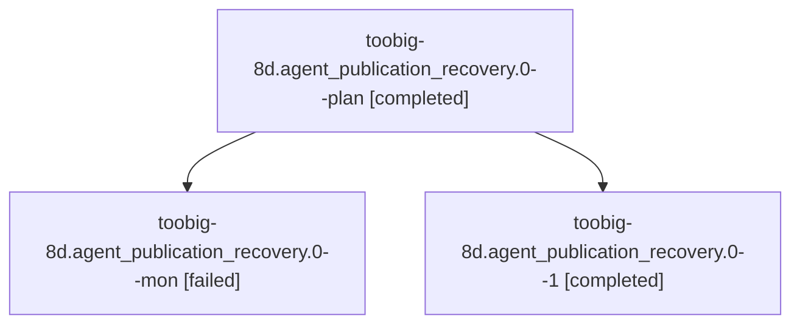

# Session: toobig-8d.agent\_publication\_recovery.0

[Agent Hoods](../README.md) / [bbugyi200](../users/bbugyi200/README.md) / [athena](../users/bbugyi200/machines/athena/README.md) / [toobig-8d](../users/bbugyi200/machines/athena/hoods/toobig-8d/README.md) / toobig-8d.agent\_publication\_recovery.0

Owner: `bbugyi200.athena` · Hood: `toobig-8d` · Members: 3

## Lineage

The diagram is an optional enhancement; the ordered table below contains the same lineage in accessible text.

| Role | Agent | State | Model / provider | Timing | Commits | Prompt | Chat |
|---|---|---|---|---|---:|---|---|
| plan | toobig-8d.agent\_publication\_recovery.0--plan | completed | muse-spark-1.3-contributor / muse | 2026-10-21T11:30:07.217055+00:00 → 2026-10-21T11:46:02.931796+00:00 | 0 | [Prompt](../agents/bbugyi200.athena.toobig-8d.agent_publication_recovery.0--plan/prompt.md) | [Chat](../agents/bbugyi200.athena.toobig-8d.agent_publication_recovery.0--plan/chat.md) |
| mon | toobig-8d.agent\_publication\_recovery.0--mon | failed | muse-spark-1.3-contributor / muse | 2026-10-21T11:45:31.495718+00:00 → 2026-10-21T11:47:46.695596+00:00 | 0 | — | [Chat](../agents/bbugyi200.athena.toobig-8d.agent_publication_recovery.0--mon/chat.md) |
| 1 | toobig-8d.agent\_publication\_recovery.0--1 | completed | muse-spark-1.3-contributor / muse | 2026-10-21T11:49:50.079791+00:00 → 2026-10-21T11:57:02.123927+00:00 | [1](../agents/bbugyi200.athena.toobig-8d.agent_publication_recovery.0--1/README.md#commits) | [Prompt](../agents/bbugyi200.athena.toobig-8d.agent_publication_recovery.0--1/prompt.md) | [Chat](../agents/bbugyi200.athena.toobig-8d.agent_publication_recovery.0--1/chat.md) |

## Commits

| Role | Repo | Commit | Subject | Committed |
|---|---|---|---|---|
| 1 | sase | [`003827a`](https://github.com/sase-org/sase/commit/003827a58d40051b742f6e1b2cebffd1e301f497) | refactor(core): split agent publication recovery into focused modules | 2026-10-21 07:53:52 EDT |

## Neighbors

| Agent | Relation | State |
|---|---|---|
| [toobig-8d.commit\_publication.0](../agents/bbugyi200.athena.toobig-8d.commit_publication.0/README.md) | toobig-8d hood | completed |
| [toobig-8d.grok.0](../agents/bbugyi200.athena.toobig-8d.grok.0/README.md) | toobig-8d hood | completed |
| [toobig-8d.publication\_replay\_recovery.0](../agents/bbugyi200.athena.toobig-8d.publication_replay_recovery.0/README.md) | toobig-8d hood | completed |
| [toobig-8d.test\_git\_sync\_outbox.0](../agents/bbugyi200.athena.toobig-8d.test_git_sync_outbox.0/README.md) | toobig-8d hood | active |
