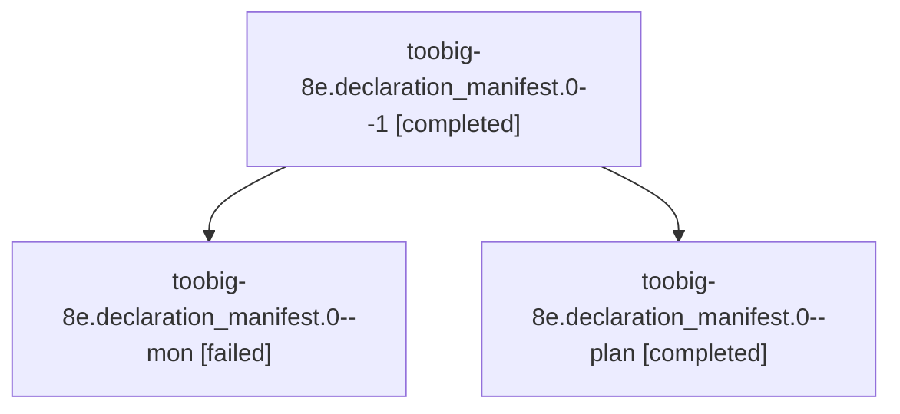

# Session: toobig-8e.declaration\_manifest.0

[Agent Hoods](../README.md) / [bbugyi200](../users/bbugyi200/README.md) / [athena](../users/bbugyi200/machines/athena/README.md) / [toobig-8e](../users/bbugyi200/machines/athena/hoods/toobig-8e/README.md) / toobig-8e.declaration\_manifest.0

Owner: `bbugyi200.athena` · Hood: `toobig-8e` · Members: 3

## Lineage

The diagram is an optional enhancement; the ordered table below contains the same lineage in accessible text.

| Role | Agent | State | Model / provider | Timing | Commits | Prompt | Chat |
|---|---|---|---|---|---:|---|---|
| 1 | toobig-8e.declaration\_manifest.0--1 | completed | muse-spark-1.3-contributor / muse | 2026-10-24T00:44:28.025123+00:00 → 2026-10-24T00:50:09.096845+00:00 | [1](../agents/bbugyi200.athena.toobig-8e.declaration_manifest.0--1/README.md#commits) | [Prompt](../agents/bbugyi200.athena.toobig-8e.declaration_manifest.0--1/prompt.md) | [Chat](../agents/bbugyi200.athena.toobig-8e.declaration_manifest.0--1/chat.md) |
| mon | toobig-8e.declaration\_manifest.0--mon | failed | muse-spark-1.3-contributor / muse | 2026-10-24T00:10:31.182820+00:00 → 2026-10-24T00:43:25.640761+00:00 | 0 | — | [Chat](../agents/bbugyi200.athena.toobig-8e.declaration_manifest.0--mon/chat.md) |
| plan | toobig-8e.declaration\_manifest.0--plan | completed | muse-spark-1.3-contributor / muse | 2026-10-23T23:44:44.989015+00:00 → 2026-10-24T00:15:55.973049+00:00 | 0 | [Prompt](../agents/bbugyi200.athena.toobig-8e.declaration_manifest.0--plan/prompt.md) | [Chat](../agents/bbugyi200.athena.toobig-8e.declaration_manifest.0--plan/chat.md) |

## Commits

| Role | Repo | Commit | Subject | Committed |
|---|---|---|---|---|
| 1 | sase | [`a2a3800`](https://github.com/sase-org/sase/commit/a2a38005dfa9d227a2c7bfc3e90cae4edaccbd20) | refactor(finalizers): split declaration\_manifest into commit and io modules | 2026-10-23 20:48:15 EDT |

## Neighbors

| Agent | Relation | State |
|---|---|---|
| [toobig-8e.test\_checks\_beads.0](../agents/bbugyi200.athena.toobig-8e.test_checks_beads.0/README.md) | toobig-8e hood | completed |
