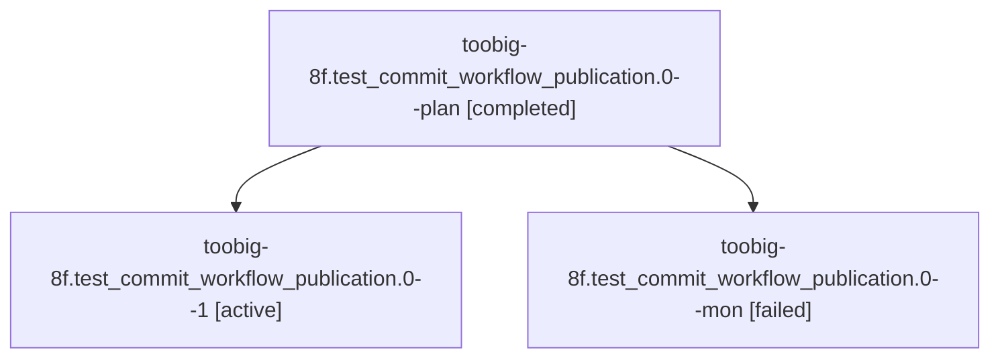

# Session: toobig-8f.test\_commit\_workflow\_publication.0

[Agent Hoods](../README.md) / [bbugyi200](../users/bbugyi200/README.md) / [athena](../users/bbugyi200/machines/athena/README.md) / [toobig-8f](../users/bbugyi200/machines/athena/hoods/toobig-8f/README.md) / toobig-8f.test\_commit\_workflow\_publication.0

Owner: `bbugyi200.athena` · Hood: `toobig-8f` · Members: 3

## Lineage

The diagram is an optional enhancement; the ordered table below contains the same lineage in accessible text.

| Role | Agent | State | Model / provider | Timing | Commits | Prompt | Chat |
|---|---|---|---|---|---:|---|---|
| plan | toobig-8f.test\_commit\_workflow\_publication.0--plan | completed | muse-spark-1.3-contributor / muse | 2026-10-24T15:42:27.293508+00:00 → 2026-10-24T16:16:09.676129+00:00 | 0 | [Prompt](../agents/bbugyi200.athena.toobig-8f.test_commit_workflow_publication.0--plan/prompt.md) | [Chat](../agents/bbugyi200.athena.toobig-8f.test_commit_workflow_publication.0--plan/chat.md) |
| 1 | toobig-8f.test\_commit\_workflow\_publication.0--1 | active | muse-spark-1.3-contributor / muse | 2026-10-24T16:40:15.049553+00:00 | [1](../agents/bbugyi200.athena.toobig-8f.test_commit_workflow_publication.0--1/README.md#commits) | [Prompt](../agents/bbugyi200.athena.toobig-8f.test_commit_workflow_publication.0--1/prompt.md) | — |
| mon | toobig-8f.test\_commit\_workflow\_publication.0--mon | failed | muse-spark-1.3-contributor / muse | 2026-10-24T16:15:06.814959+00:00 → 2026-10-24T16:35:57.279706+00:00 | 0 | — | [Chat](../agents/bbugyi200.athena.toobig-8f.test_commit_workflow_publication.0--mon/chat.md) |

## Commits

| Role | Repo | Commit | Subject | Committed |
|---|---|---|---|---|
| 1 | sase | [`3f5f6dd`](https://github.com/sase-org/sase/commit/3f5f6ddc8a260074e17e916cc86f5052baa72e07) | test(toobig): split test\_commit\_workflow\_publication into focused modules | 2026-10-24 12:48:55 EDT |
