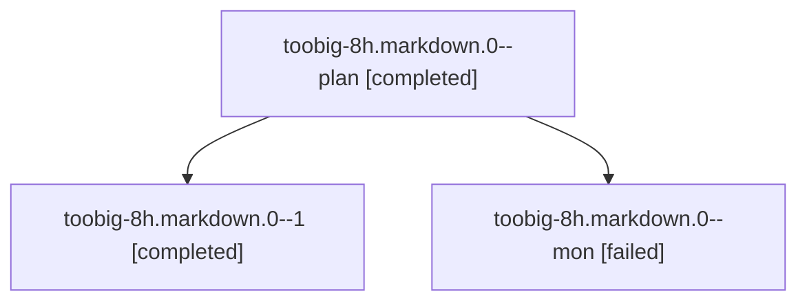

# Session: toobig-8h.markdown.0

[Agent Hoods](../README.md) / [bbugyi200](../users/bbugyi200/README.md) / [athena](../users/bbugyi200/machines/athena/README.md) / [toobig-8h](../users/bbugyi200/machines/athena/hoods/toobig-8h/README.md) / toobig-8h.markdown.0

Owner: `bbugyi200.athena` · Hood: `toobig-8h` · Members: 3

## Lineage

The diagram is an optional enhancement; the ordered table below contains the same lineage in accessible text.

| Role | Agent | State | Model / provider | Timing | Commits | Prompt | Chat |
|---|---|---|---|---|---:|---|---|
| plan | toobig-8h.markdown.0--plan | completed | muse-spark-1.3-contributor / muse | 2026-10-25T19:43:39.762232+00:00 → 2026-10-25T20:10:53.754158+00:00 | 0 | [Prompt](../agents/bbugyi200.athena.toobig-8h.markdown.0--plan/prompt.md) | [Chat](../agents/bbugyi200.athena.toobig-8h.markdown.0--plan/chat.md) |
| 1 | toobig-8h.markdown.0--1 | completed | muse-spark-1.3-contributor / muse | 2026-10-25T20:15:02.580671+00:00 → 2026-10-25T20:22:46.830443+00:00 | [1](../agents/bbugyi200.athena.toobig-8h.markdown.0--1/README.md#commits) | [Prompt](../agents/bbugyi200.athena.toobig-8h.markdown.0--1/prompt.md) | [Chat](../agents/bbugyi200.athena.toobig-8h.markdown.0--1/chat.md) |
| mon | toobig-8h.markdown.0--mon | failed | muse-spark-1.3-contributor / muse | 2026-10-25T20:08:20.280502+00:00 → 2026-10-25T20:13:47.348589+00:00 | 0 | — | [Chat](../agents/bbugyi200.athena.toobig-8h.markdown.0--mon/chat.md) |

## Commits

| Role | Repo | Commit | Subject | Committed |
|---|---|---|---|---|
| 1 | sase | [`57545a1`](https://github.com/sase-org/sase/commit/57545a1742951c74109c10aba0024df63fd0c81d) | refactor(stats): split markdown renderer into focused modules | 2026-10-25 16:20:12 EDT |

## Neighbors

| Agent | Relation | State |
|---|---|---|
| [toobig-8h.project\_render\_fixtures.0](../agents/bbugyi200.athena.toobig-8h.project_render_fixtures.0/README.md) | toobig-8h hood | completed |
