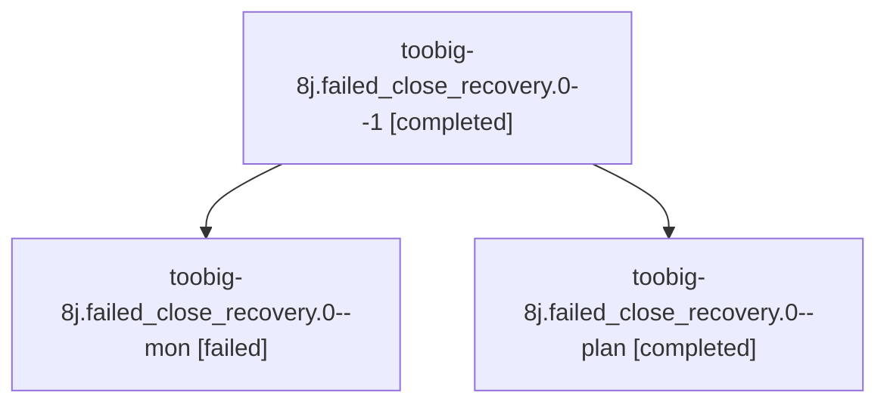

# Session: toobig-8j.failed\_close\_recovery.0

[Agent Hoods](../README.md) / [bbugyi200](../users/bbugyi200/README.md) / [athena](../users/bbugyi200/machines/athena/README.md) / [toobig-8j](../users/bbugyi200/machines/athena/hoods/toobig-8j/README.md) / toobig-8j.failed\_close\_recovery.0

Owner: `bbugyi200.athena` · Hood: `toobig-8j` · Members: 3

## Lineage

The diagram is an optional enhancement; the ordered table below contains the same lineage in accessible text.

| Role | Agent | State | Model / provider | Timing | Commits | Prompt | Chat |
|---|---|---|---|---|---:|---|---|
| 1 | toobig-8j.failed\_close\_recovery.0--1 | completed | grok-4.6 / grok | 2026-10-27T03:46:12.806761+00:00 → 2026-10-27T03:56:32.677799+00:00 | 0 | [Prompt](../agents/bbugyi200.athena.toobig-8j.failed_close_recovery.0--1/prompt.md) | [Chat](../agents/bbugyi200.athena.toobig-8j.failed_close_recovery.0--1/chat.md) |
| mon | toobig-8j.failed\_close\_recovery.0--mon | failed | grok-4.6 / grok | 2026-10-27T03:26:02.420217+00:00 → 2026-10-27T03:44:10.494348+00:00 | [1](../agents/bbugyi200.athena.toobig-8j.failed_close_recovery.0--mon/README.md#commits) | — | [Chat](../agents/bbugyi200.athena.toobig-8j.failed_close_recovery.0--mon/chat.md) |
| plan | toobig-8j.failed\_close\_recovery.0--plan | completed | grok-4.6 / grok | 2026-10-27T03:13:38.602338+00:00 → 2026-10-27T03:27:35.571096+00:00 | 0 | [Prompt](../agents/bbugyi200.athena.toobig-8j.failed_close_recovery.0--plan/prompt.md) | [Chat](../agents/bbugyi200.athena.toobig-8j.failed_close_recovery.0--plan/chat.md) |

## Commits

| Role | Repo | Commit | Subject | Committed |
|---|---|---|---|---|
| mon | sase | [`3355eb2`](https://github.com/sase-org/sase/commit/3355eb275cffe19dadce5c23cb99ed19bdf733dd) | refactor(finalizers): split failed\_close\_recovery into focused modules | 2026-10-26 23:40:13 EDT |

## Neighbors

| Agent | Relation | State |
|---|---|---|
| [toobig-8j.test\_finalizers\_failed\_close\_recovery.0](bbugyi200.athena.toobig-8j.test_finalizers_failed_close_recovery.0.md) (session · 3) | toobig-8j hood | active 1, completed 1, failed 1 |
