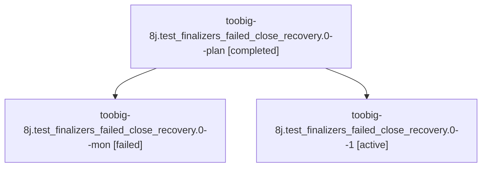

# Session: toobig-8j.test\_finalizers\_failed\_close\_recovery.0

[Agent Hoods](../README.md) / [bbugyi200](../users/bbugyi200/README.md) / [athena](../users/bbugyi200/machines/athena/README.md) / [toobig-8j](../users/bbugyi200/machines/athena/hoods/toobig-8j/README.md) / toobig-8j.test\_finalizers\_failed\_close\_recovery.0

Owner: `bbugyi200.athena` · Hood: `toobig-8j` · Members: 3

## Lineage

The diagram is an optional enhancement; the ordered table below contains the same lineage in accessible text.

| Role | Agent | State | Model / provider | Timing | Commits | Prompt | Chat |
|---|---|---|---|---|---:|---|---|
| plan | toobig-8j.test\_finalizers\_failed\_close\_recovery.0--plan | completed | muse-spark-1.3-contributor / muse | 2026-10-27T04:59:09.759494+00:00 → 2026-10-27T05:27:36.000970+00:00 | 0 | [Prompt](../agents/bbugyi200.athena.toobig-8j.test_finalizers_failed_close_recovery.0--plan/prompt.md) | [Chat](../agents/bbugyi200.athena.toobig-8j.test_finalizers_failed_close_recovery.0--plan/chat.md) |
| mon | toobig-8j.test\_finalizers\_failed\_close\_recovery.0--mon | failed | muse-spark-1.3-contributor / muse | 2026-10-27T05:25:03.869704+00:00 → 2026-10-27T05:37:23.644447+00:00 | 0 | — | [Chat](../agents/bbugyi200.athena.toobig-8j.test_finalizers_failed_close_recovery.0--mon/chat.md) |
| 1 | toobig-8j.test\_finalizers\_failed\_close\_recovery.0--1 | active | muse-spark-1.3-contributor / muse | 2026-10-27T05:37:09.100143+00:00 | [1](../agents/bbugyi200.athena.toobig-8j.test_finalizers_failed_close_recovery.0--1/README.md#commits) | [Prompt](../agents/bbugyi200.athena.toobig-8j.test_finalizers_failed_close_recovery.0--1/prompt.md) | — |

## Commits

| Role | Repo | Commit | Subject | Committed |
|---|---|---|---|---|
| 1 | sase | [`134e869`](https://github.com/sase-org/sase/commit/134e869e4b9b18f85e0f3a4c003d70a9923c0534) | test: split test\_finalizers\_failed\_close\_recovery into focused modules | 2026-10-27 01:41:26 EDT |

## Neighbors

| Agent | Relation | State |
|---|---|---|
| [toobig-8j.failed\_close\_recovery.0](bbugyi200.athena.toobig-8j.failed_close_recovery.0.md) (session · 3) | toobig-8j hood | completed 2, failed 1 |
