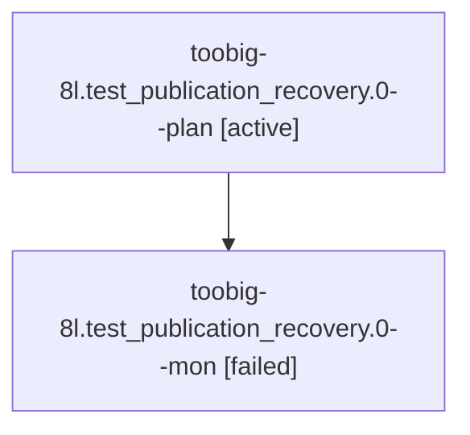

# Session: toobig-8l.test\_publication\_recovery.0

[Agent Hoods](../README.md) / [bbugyi200](../users/bbugyi200/README.md) / [athena](../users/bbugyi200/machines/athena/README.md) / [toobig-8l](../users/bbugyi200/machines/athena/hoods/toobig-8l/README.md) / toobig-8l.test\_publication\_recovery.0

Owner: `bbugyi200.athena` · Hood: `toobig-8l` · Members: 2

## Lineage

The diagram is an optional enhancement; the ordered table below contains the same lineage in accessible text.

| Role | Agent | State | Model / provider | Timing | Commits | Prompt | Chat |
|---|---|---|---|---|---:|---|---|
| plan | toobig-8l.test\_publication\_recovery.0--plan | active | muse-spark-1.3-contributor / muse | 2026-10-27T10:49:36.007054+00:00 | [1](../agents/bbugyi200.athena.toobig-8l.test_publication_recovery.0--plan/README.md#commits) | [Prompt](../agents/bbugyi200.athena.toobig-8l.test_publication_recovery.0--plan/prompt.md) | — |
| mon | toobig-8l.test\_publication\_recovery.0--mon | failed | muse-spark-1.3-contributor / muse | 2026-10-27T11:05:07.064783+00:00 → 2026-10-27T11:05:07.127727+00:00 | 0 | — | — |

## Commits

| Role | Repo | Commit | Subject | Committed |
|---|---|---|---|---|
| plan | sase | [`887175c`](https://github.com/sase-org/sase/commit/887175c3e5e6e9c3567f00ea17bd7ef1c608195e) | refactor(agents-sync): split publication recovery tests into package | 2026-10-27 07:06:11 EDT |

## Neighbors

| Agent | Relation | State |
|---|---|---|
| [toobig-8l.commit\_publication\_transaction.0](../agents/bbugyi200.athena.toobig-8l.commit_publication_transaction.0/README.md) | toobig-8l hood | completed |
| [toobig-8l.git\_sync\_ops.0](../agents/bbugyi200.athena.toobig-8l.git_sync_ops.0/README.md) | toobig-8l hood | completed |
| [toobig-8l.test\_axe\_chop\_wait\_checks\_stranded\_beads.0](../agents/bbugyi200.athena.toobig-8l.test_axe_chop_wait_checks_stranded_beads.0/README.md) | toobig-8l hood | waiting |
