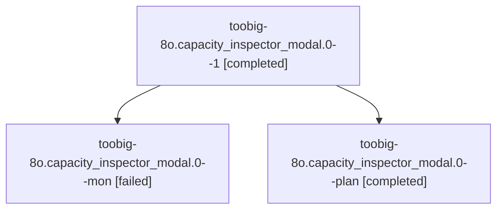

# Session: toobig-8o.capacity\_inspector\_modal.0

[Agent Hoods](../README.md) / [bbugyi200](../users/bbugyi200/README.md) / [athena](../users/bbugyi200/machines/athena/README.md) / [toobig-8o](../users/bbugyi200/machines/athena/hoods/toobig-8o/README.md) / toobig-8o.capacity\_inspector\_modal.0

Owner: `bbugyi200.athena` · Hood: `toobig-8o` · Members: 3

## Lineage

The diagram is an optional enhancement; the ordered table below contains the same lineage in accessible text.

| Role | Agent | State | Model / provider | Timing | Commits | Prompt | Chat |
|---|---|---|---|---|---:|---|---|
| 1 | toobig-8o.capacity\_inspector\_modal.0--1 | completed | muse-spark-1.3-contributor / muse | 2026-10-27T21:02:00.243961+00:00 → 2026-10-27T21:07:50.480781+00:00 | [1](../agents/bbugyi200.athena.toobig-8o.capacity_inspector_modal.0--1/README.md#commits) | [Prompt](../agents/bbugyi200.athena.toobig-8o.capacity_inspector_modal.0--1/prompt.md) | [Chat](../agents/bbugyi200.athena.toobig-8o.capacity_inspector_modal.0--1/chat.md) |
| mon | toobig-8o.capacity\_inspector\_modal.0--mon | failed | muse-spark-1.3-contributor / muse | 2026-10-27T20:58:06.281447+00:00 → 2026-10-27T21:00:36.112473+00:00 | 0 | — | [Chat](../agents/bbugyi200.athena.toobig-8o.capacity_inspector_modal.0--mon/chat.md) |
| plan | toobig-8o.capacity\_inspector\_modal.0--plan | completed | muse-spark-1.3-contributor / muse | 2026-10-27T20:44:04.956208+00:00 → 2026-10-27T20:58:44.027662+00:00 | 0 | [Prompt](../agents/bbugyi200.athena.toobig-8o.capacity_inspector_modal.0--plan/prompt.md) | [Chat](../agents/bbugyi200.athena.toobig-8o.capacity_inspector_modal.0--plan/chat.md) |

## Commits

| Role | Repo | Commit | Subject | Committed |
|---|---|---|---|---|
| 1 | sase | [`4a2baf9`](https://github.com/sase-org/sase/commit/4a2baf9b193405bf7f24d8a9ce38ff7e2536e9b8) | refactor(capacity-inspector): split modal into screen, options, and shared modules | 2026-10-27 17:05:59 EDT |

## Neighbors

| Agent | Relation | State |
|---|---|---|
| [toobig-8o.panel\_spread.0](../agents/bbugyi200.athena.toobig-8o.panel_spread.0/README.md) | toobig-8o hood | active |
