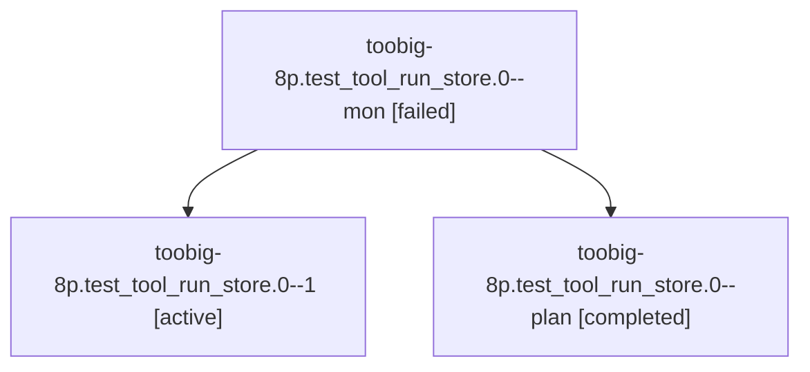

# Session: toobig-8p.test\_tool\_run\_store.0

[Agent Hoods](../README.md) / [bbugyi200](../users/bbugyi200/README.md) / [athena](../users/bbugyi200/machines/athena/README.md) / [toobig-8p](../users/bbugyi200/machines/athena/hoods/toobig-8p/README.md) / toobig-8p.test\_tool\_run\_store.0

Owner: `bbugyi200.athena` · Hood: `toobig-8p` · Members: 3

## Lineage

The diagram is an optional enhancement; the ordered table below contains the same lineage in accessible text.

| Role | Agent | State | Model / provider | Timing | Commits | Prompt | Chat |
|---|---|---|---|---|---:|---|---|
| mon | toobig-8p.test\_tool\_run\_store.0--mon | failed | muse-spark-1.3-contributor / muse | 2026-10-28T00:39:12.584338+00:00 → 2026-10-28T00:42:21.954141+00:00 | 0 | — | [Chat](../agents/bbugyi200.athena.toobig-8p.test_tool_run_store.0--mon/chat.md) |
| 1 | toobig-8p.test\_tool\_run\_store.0--1 | active | muse-spark-1.3-contributor / muse | 2026-10-28T00:44:11.522645+00:00 | [1](../agents/bbugyi200.athena.toobig-8p.test_tool_run_store.0--1/README.md#commits) | [Prompt](../agents/bbugyi200.athena.toobig-8p.test_tool_run_store.0--1/prompt.md) | — |
| plan | toobig-8p.test\_tool\_run\_store.0--plan | completed | muse-spark-1.3-contributor / muse | 2026-10-28T00:19:29.658286+00:00 → 2026-10-28T00:40:37.536385+00:00 | 0 | [Prompt](../agents/bbugyi200.athena.toobig-8p.test_tool_run_store.0--plan/prompt.md) | [Chat](../agents/bbugyi200.athena.toobig-8p.test_tool_run_store.0--plan/chat.md) |

## Commits

| Role | Repo | Commit | Subject | Committed |
|---|---|---|---|---|
| 1 | sase | [`8b7fb0b`](https://github.com/sase-org/sase/commit/8b7fb0bb6e615d7564b83d107850eaad50d9b1aa) | test(tool-run): split test\_tool\_run\_store into focused modules | 2026-10-27 20:49:27 EDT |

## Neighbors

| Agent | Relation | State |
|---|---|---|
| [toobig-8p.catalog\_gen.0](../agents/bbugyi200.athena.toobig-8p.catalog_gen.0/README.md) | toobig-8p hood | completed |
