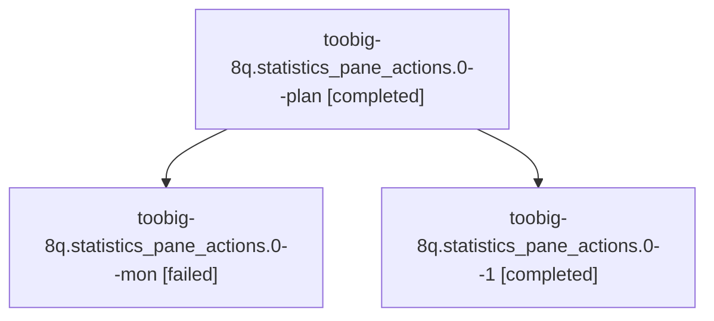

# Session: toobig-8q.statistics\_pane\_actions.0

[Agent Hoods](../README.md) / [bbugyi200](../users/bbugyi200/README.md) / [athena](../users/bbugyi200/machines/athena/README.md) / [toobig-8q](../users/bbugyi200/machines/athena/hoods/toobig-8q/README.md) / toobig-8q.statistics\_pane\_actions.0

Owner: `bbugyi200.athena` · Hood: `toobig-8q` · Members: 3

## Lineage

The diagram is an optional enhancement; the ordered table below contains the same lineage in accessible text.

| Role | Agent | State | Model / provider | Timing | Commits | Prompt | Chat |
|---|---|---|---|---|---:|---|---|
| plan | toobig-8q.statistics\_pane\_actions.0--plan | completed | muse-spark-1.3-contributor / muse | 2026-10-28T12:06:54.504767+00:00 → 2026-10-28T12:44:11.743138+00:00 | 0 | [Prompt](../agents/bbugyi200.athena.toobig-8q.statistics_pane_actions.0--plan/prompt.md) | [Chat](../agents/bbugyi200.athena.toobig-8q.statistics_pane_actions.0--plan/chat.md) |
| mon | toobig-8q.statistics\_pane\_actions.0--mon | failed | muse-spark-1.3-contributor / muse | 2026-10-28T12:42:16.563239+00:00 → 2026-10-28T13:05:59.530021+00:00 | 0 | — | [Chat](../agents/bbugyi200.athena.toobig-8q.statistics_pane_actions.0--mon/chat.md) |
| 1 | toobig-8q.statistics\_pane\_actions.0--1 | completed | muse-spark-1.3-contributor / muse | 2026-10-28T13:04:20.298886+00:00 → 2026-10-28T13:13:18.041662+00:00 | [1](../agents/bbugyi200.athena.toobig-8q.statistics_pane_actions.0--1/README.md#commits) | [Prompt](../agents/bbugyi200.athena.toobig-8q.statistics_pane_actions.0--1/prompt.md) | [Chat](../agents/bbugyi200.athena.toobig-8q.statistics_pane_actions.0--1/chat.md) |

## Commits

| Role | Repo | Commit | Subject | Committed |
|---|---|---|---|---|
| 1 | sase | [`8f75f44`](https://github.com/sase-org/sase/commit/8f75f44e9237594ad72a55eb4feaa0e4738263fe) | refactor(ace): split statistics\_pane\_actions into views, footprint, and filters modules | 2026-10-28 09:11:09 EDT |

## Neighbors

| Agent | Relation | State |
|---|---|---|
| [toobig-8q.artifact\_link\_event\_publish.0](../agents/bbugyi200.athena.toobig-8q.artifact_link_event_publish.0/README.md) | toobig-8q hood | completed |
| [toobig-8q.entry.0](../agents/bbugyi200.athena.toobig-8q.entry.0/README.md) | toobig-8q hood | completed |
| [toobig-8q.snapshot\_capture.0](../agents/bbugyi200.athena.toobig-8q.snapshot_capture.0/README.md) | toobig-8q hood | completed |
| [toobig-8q.statistics\_pane.0](../agents/bbugyi200.athena.toobig-8q.statistics_pane.0/README.md) | toobig-8q hood | completed |
| [toobig-8q.statistics\_pane\_helpers.0](../agents/bbugyi200.athena.toobig-8q.statistics_pane_helpers.0/README.md) | toobig-8q hood | completed |
| [toobig-8q.test\_ace\_png\_snapshots\_config\_center\_statistics.0](../agents/bbugyi200.athena.toobig-8q.test_ace_png_snapshots_config_center_statistics.0/README.md) | toobig-8q hood | completed |
| [toobig-8q.test\_artifact\_link\_quarantine\_replay\_evidence.0](bbugyi200.athena.toobig-8q.test_artifact_link_quarantine_replay_evidence.0.md) (session · 3) | toobig-8q hood | active 1, completed 1, failed 1 |
| [toobig-8q.test\_axe\_runner\_workspace\_reclone.0](../agents/bbugyi200.athena.toobig-8q.test_axe_runner_workspace_reclone.0/README.md) | toobig-8q hood | waiting |
| [toobig-8q.test\_reset\_replay.0](../agents/bbugyi200.athena.toobig-8q.test_reset_replay.0/README.md) | toobig-8q hood | waiting |
