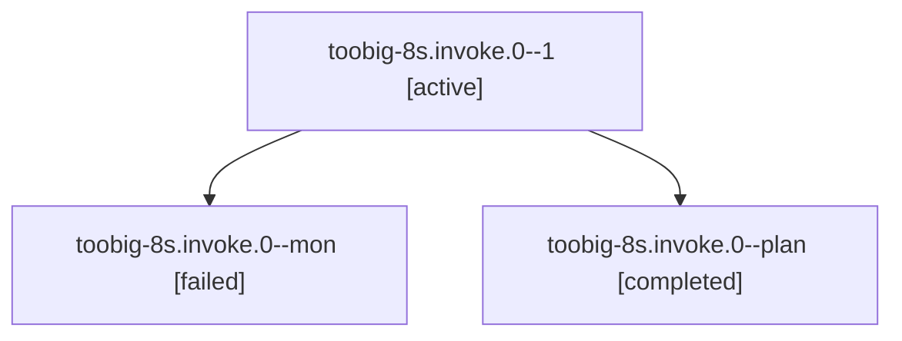

# Session: toobig-8s.invoke.0

[Agent Hoods](../README.md) / [bbugyi200](../users/bbugyi200/README.md) / [athena](../users/bbugyi200/machines/athena/README.md) / [toobig-8s](../users/bbugyi200/machines/athena/hoods/toobig-8s/README.md) / toobig-8s.invoke.0

Owner: `bbugyi200.athena` · Hood: `toobig-8s` · Members: 3

## Lineage

The diagram is an optional enhancement; the ordered table below contains the same lineage in accessible text.

| Role | Agent | State | Model / provider | Timing | Commits | Prompt | Chat |
|---|---|---|---|---|---:|---|---|
| 1 | toobig-8s.invoke.0--1 | active | gpt-6-luna / codex | 2026-10-29T07:08:00.089725+00:00 | [1](../agents/bbugyi200.athena.toobig-8s.invoke.0--1/README.md#commits) | [Prompt](../agents/bbugyi200.athena.toobig-8s.invoke.0--1/prompt.md) | — |
| mon | toobig-8s.invoke.0--mon | failed | gpt-6-luna / codex | 2026-10-29T07:02:49.334328+00:00 → 2026-10-29T07:07:26.971303+00:00 | 0 | — | [Chat](../agents/bbugyi200.athena.toobig-8s.invoke.0--mon/chat.md) |
| plan | toobig-8s.invoke.0--plan | completed | gpt-6-luna / codex | 2026-10-29T06:58:44.584330+00:00 → 2026-10-29T07:05:32.616755+00:00 | 0 | [Prompt](../agents/bbugyi200.athena.toobig-8s.invoke.0--plan/prompt.md) | [Chat](../agents/bbugyi200.athena.toobig-8s.invoke.0--plan/chat.md) |

## Commits

| Role | Repo | Commit | Subject | Committed |
|---|---|---|---|---|
| 1 | sase | [`e056c6b`](https://github.com/sase-org/sase/commit/e056c6b8c035e92f5e2abc25b181cb7ba2d04f12) | refactor(llm-provider): split invocation orchestration | 2026-10-29 04:06:12 EDT |
