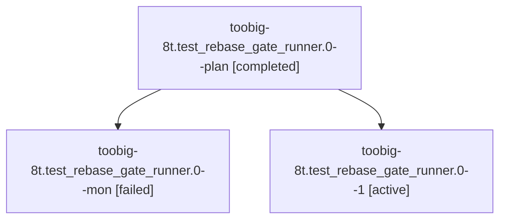

# Session: toobig-8t.test\_rebase\_gate\_runner.0

[Agent Hoods](../README.md) / [bbugyi200](../users/bbugyi200/README.md) / [athena](../users/bbugyi200/machines/athena/README.md) / [toobig-8t](../users/bbugyi200/machines/athena/hoods/toobig-8t/README.md) / toobig-8t.test\_rebase\_gate\_runner.0

Owner: `bbugyi200.athena` · Hood: `toobig-8t` · Members: 3

## Lineage

The diagram is an optional enhancement; the ordered table below contains the same lineage in accessible text.

| Role | Agent | State | Model / provider | Timing | Commits | Prompt | Chat |
|---|---|---|---|---|---:|---|---|
| plan | toobig-8t.test\_rebase\_gate\_runner.0--plan | completed | muse-spark-1.3-contributor / muse | 2026-10-29T22:05:22.168162+00:00 → 2026-10-29T22:27:42.490932+00:00 | 0 | [Prompt](../agents/bbugyi200.athena.toobig-8t.test_rebase_gate_runner.0--plan/prompt.md) | [Chat](../agents/bbugyi200.athena.toobig-8t.test_rebase_gate_runner.0--plan/chat.md) |
| mon | toobig-8t.test\_rebase\_gate\_runner.0--mon | failed | muse-spark-1.3-contributor / muse | 2026-10-29T22:25:38.482511+00:00 → 2026-10-29T22:47:36.792121+00:00 | 0 | — | [Chat](../agents/bbugyi200.athena.toobig-8t.test_rebase_gate_runner.0--mon/chat.md) |
| 1 | toobig-8t.test\_rebase\_gate\_runner.0--1 | active | muse-spark-1.3-contributor / muse | 2026-10-29T22:50:28.362629+00:00 | [1](../agents/bbugyi200.athena.toobig-8t.test_rebase_gate_runner.0--1/README.md#commits) | [Prompt](../agents/bbugyi200.athena.toobig-8t.test_rebase_gate_runner.0--1/prompt.md) | — |

## Commits

| Role | Repo | Commit | Subject | Committed |
|---|---|---|---|---|
| 1 | sase | [`f94ad24`](https://github.com/sase-org/sase/commit/f94ad24a4a9f15e9d76a2284a39a588dd4c2d17f) | test(rebase-gate): split runner tests into focused modules | 2026-10-29 19:17:16 EDT |

## Neighbors

| Agent | Relation | State |
|---|---|---|
| [toobig-8t.rebase\_gate\_runner.0](bbugyi200.athena.toobig-8t.rebase_gate_runner.0.md) (session · 3) | toobig-8t hood | completed 2, failed 1 |
| [toobig-8t.test\_monitor\_host\_completion.0](../agents/bbugyi200.athena.toobig-8t.test_monitor_host_completion.0/README.md) | toobig-8t hood | completed |
| [toobig-8t.workflow.0](bbugyi200.athena.toobig-8t.workflow.0.md) (session · 7) | toobig-8t hood | completed 4, failed 3 |
