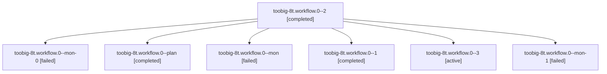

# Session: toobig-8t.workflow.0

[Agent Hoods](../README.md) / [bbugyi200](../users/bbugyi200/README.md) / [athena](../users/bbugyi200/machines/athena/README.md) / [toobig-8t](../users/bbugyi200/machines/athena/hoods/toobig-8t/README.md) / toobig-8t.workflow.0

Owner: `bbugyi200.athena` · Hood: `toobig-8t` · Members: 7

## Lineage

The diagram is an optional enhancement; the ordered table below contains the same lineage in accessible text.

| Role | Agent | State | Model / provider | Timing | Commits | Prompt | Chat |
|---|---|---|---|---|---:|---|---|
| 2 | toobig-8t.workflow.0--2 | completed | gpt-6-luna / codex | 2026-10-29T19:37:14.695797+00:00 → 2026-10-29T19:45:35.205295+00:00 | 0 | [Prompt](../agents/bbugyi200.athena.toobig-8t.workflow.0--2/prompt.md) | [Chat](../agents/bbugyi200.athena.toobig-8t.workflow.0--2/chat.md) |
| mon-0 | toobig-8t.workflow.0--mon-0 | failed | gpt-6-luna / codex | 2026-10-29T19:18:24.410403+00:00 → 2026-10-29T19:35:03.197984+00:00 | 0 | — | [Chat](../agents/bbugyi200.athena.toobig-8t.workflow.0--mon-0/chat.md) |
| plan | toobig-8t.workflow.0--plan | completed | gpt-6-luna / codex | 2026-10-29T17:15:50.202993+00:00 → 2026-10-29T17:48:09.284323+00:00 | 0 | [Prompt](../agents/bbugyi200.athena.toobig-8t.workflow.0--plan/prompt.md) | [Chat](../agents/bbugyi200.athena.toobig-8t.workflow.0--plan/chat.md) |
| mon | toobig-8t.workflow.0--mon | failed | gpt-6-luna / codex | 2026-10-29T17:47:25.086716+00:00 → 2026-10-29T19:09:07.526928+00:00 | 0 | — | [Chat](../agents/bbugyi200.athena.toobig-8t.workflow.0--mon/chat.md) |
| 1 | toobig-8t.workflow.0--1 | completed | gpt-6-luna / codex | 2026-10-29T19:12:04.962975+00:00 → 2026-10-29T19:20:07.008938+00:00 | 0 | [Prompt](../agents/bbugyi200.athena.toobig-8t.workflow.0--1/prompt.md) | [Chat](../agents/bbugyi200.athena.toobig-8t.workflow.0--1/chat.md) |
| 3 | toobig-8t.workflow.0--3 | active | gpt-6-luna / codex | 2026-10-29T19:57:10.500242+00:00 | [1](../agents/bbugyi200.athena.toobig-8t.workflow.0--3/README.md#commits) | [Prompt](../agents/bbugyi200.athena.toobig-8t.workflow.0--3/prompt.md) | — |
| mon-1 | toobig-8t.workflow.0--mon-1 | failed | gpt-6-luna / codex | 2026-10-29T19:42:58.640432+00:00 → 2026-10-29T19:56:08.831825+00:00 | 0 | — | [Chat](../agents/bbugyi200.athena.toobig-8t.workflow.0--mon-1/chat.md) |

## Commits

| Role | Repo | Commit | Subject | Committed |
|---|---|---|---|---|
| 3 | sase | [`7e562f5`](https://github.com/sase-org/sase/commit/7e562f58f8b29a65e09781342a2b754fa85bb204) | refactor(commit): split commit workflow tracking | 2026-10-29 16:01:22 EDT |

## Neighbors

| Agent | Relation | State |
|---|---|---|
| [toobig-8t.rebase\_gate\_runner.0](bbugyi200.athena.toobig-8t.rebase_gate_runner.0.md) (session · 3) | toobig-8t hood | completed 2, failed 1 |
| [toobig-8t.test\_monitor\_host\_completion.0](../agents/bbugyi200.athena.toobig-8t.test_monitor_host_completion.0/README.md) | toobig-8t hood | waiting |
| [toobig-8t.test\_rebase\_gate\_runner.0](../agents/bbugyi200.athena.toobig-8t.test_rebase_gate_runner.0/README.md) | toobig-8t hood | waiting |
