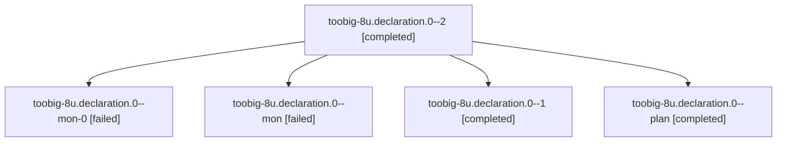

# Session: toobig-8u.declaration.0

[Agent Hoods](../README.md) / [bbugyi200](../users/bbugyi200/README.md) / [athena](../users/bbugyi200/machines/athena/README.md) / [toobig-8u](../users/bbugyi200/machines/athena/hoods/toobig-8u/README.md) / toobig-8u.declaration.0

Owner: `bbugyi200.athena` · Hood: `toobig-8u` · Members: 5

## Lineage

The diagram is an optional enhancement; the ordered table below contains the same lineage in accessible text.

| Role | Agent | State | Model / provider | Timing | Commits | Prompt | Chat |
|---|---|---|---|---|---:|---|---|
| 2 | toobig-8u.declaration.0--2 | completed | muse-spark-1.3-contributor / muse | 2026-10-30T08:24:17.641802+00:00 → 2026-10-30T08:40:14.117349+00:00 | [1](../agents/bbugyi200.athena.toobig-8u.declaration.0--2/README.md#commits) | [Prompt](../agents/bbugyi200.athena.toobig-8u.declaration.0--2/prompt.md) | [Chat](../agents/bbugyi200.athena.toobig-8u.declaration.0--2/chat.md) |
| mon-0 | toobig-8u.declaration.0--mon-0 | failed | gpt-6-luna / codex | 2026-10-30T08:14:53.425946+00:00 → 2026-10-30T08:21:50.608083+00:00 | 0 | — | [Chat](../agents/bbugyi200.athena.toobig-8u.declaration.0--mon-0/chat.md) |
| mon | toobig-8u.declaration.0--mon | failed | gpt-6-luna / codex | 2026-10-30T07:41:06.498430+00:00 → 2026-10-30T08:00:08.650351+00:00 | 0 | — | [Chat](../agents/bbugyi200.athena.toobig-8u.declaration.0--mon/chat.md) |
| 1 | toobig-8u.declaration.0--1 | completed | gpt-6-luna / codex | 2026-10-30T08:03:04.989070+00:00 → 2026-10-30T08:15:05.450189+00:00 | 0 | [Prompt](../agents/bbugyi200.athena.toobig-8u.declaration.0--1/prompt.md) | [Chat](../agents/bbugyi200.athena.toobig-8u.declaration.0--1/chat.md) |
| plan | toobig-8u.declaration.0--plan | completed | gpt-6-luna / codex | 2026-10-30T06:45:36.537830+00:00 → 2026-10-30T07:41:30.724960+00:00 | 0 | [Prompt](../agents/bbugyi200.athena.toobig-8u.declaration.0--plan/prompt.md) | [Chat](../agents/bbugyi200.athena.toobig-8u.declaration.0--plan/chat.md) |

## Commits

| Role | Repo | Commit | Subject | Committed |
|---|---|---|---|---|
| 2 | sase | [`302f58e`](https://github.com/sase-org/sase/commit/302f58e9adf62e2d4b8c70d712fccecd14fe3174) | refactor(finalizer): split declaration into focused modules | 2026-10-30 04:38:21 EDT |

## Neighbors

| Agent | Relation | State |
|---|---|---|
| [toobig-8u.agent\_list\_render\_rail.0](../agents/bbugyi200.athena.toobig-8u.agent_list_render_rail.0/README.md) | toobig-8u hood | completed |
| [toobig-8u.reclaim.0](bbugyi200.athena.toobig-8u.reclaim.0.md) (session · 7) | toobig-8u hood | active 1, completed 3, failed 3 |
| [toobig-8u.run\_agent\_exec\_staged.0](bbugyi200.athena.toobig-8u.run_agent_exec_staged.0.md) (session · 3) | toobig-8u hood | completed 2, failed 1 |
| [toobig-8u.test\_rebase\_gate\_runner.0](../agents/bbugyi200.athena.toobig-8u.test_rebase_gate_runner.0/README.md) | toobig-8u hood | waiting |
| [toobig-8u.workspace\_handler\_maintenance.0](../agents/bbugyi200.athena.toobig-8u.workspace_handler_maintenance.0/README.md) | toobig-8u hood | waiting |
