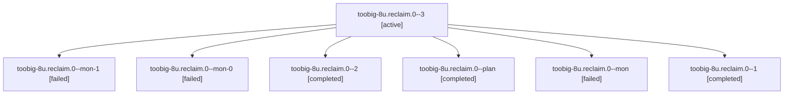

# Session: toobig-8u.reclaim.0

[Agent Hoods](../README.md) / [bbugyi200](../users/bbugyi200/README.md) / [athena](../users/bbugyi200/machines/athena/README.md) / [toobig-8u](../users/bbugyi200/machines/athena/hoods/toobig-8u/README.md) / toobig-8u.reclaim.0

Owner: `bbugyi200.athena` · Hood: `toobig-8u` · Members: 7

## Lineage



The diagram is an optional enhancement; the ordered table below contains the same lineage in accessible text.

| Role | Agent | State | Model / provider | Timing | Commits | Prompt | Chat |
|---|---|---|---|---|---:|---|---|
| <a id="member-3"></a>3 | toobig-8u.reclaim.0--3 | active | muse-spark-1.3-contributor / muse | 2026-10-30T11:10:30.931146+00:00 | [1](../agents/bbugyi200.athena.toobig-8u.reclaim.0--3/README.md#commits) | [Prompt](../agents/bbugyi200.athena.toobig-8u.reclaim.0--3/prompt.md) | — |
| <a id="member-mon-1"></a>mon-1 | toobig-8u.reclaim.0--mon-1 | failed | gpt-6-luna / codex | 2026-10-30T10:46:33.652548+00:00 → 2026-10-30T11:08:37.965114+00:00 | 0 | — | [Chat](../agents/bbugyi200.athena.toobig-8u.reclaim.0--mon-1/chat.md) |
| <a id="member-mon-0"></a>mon-0 | toobig-8u.reclaim.0--mon-0 | failed | gpt-6-luna / codex | 2026-10-30T10:25:08.231232+00:00 → 2026-10-30T10:31:58.546287+00:00 | 0 | — | [Chat](../agents/bbugyi200.athena.toobig-8u.reclaim.0--mon-0/chat.md) |
| <a id="member-2"></a>2 | toobig-8u.reclaim.0--2 | completed | gpt-6-luna / codex | 2026-10-30T10:34:06.173589+00:00 → 2026-10-30T10:46:41.752561+00:00 | 0 | [Prompt](../agents/bbugyi200.athena.toobig-8u.reclaim.0--2/prompt.md) | [Chat](../agents/bbugyi200.athena.toobig-8u.reclaim.0--2/chat.md) |
| <a id="member-plan"></a>plan | toobig-8u.reclaim.0--plan | completed | gpt-6-luna / codex | 2026-10-30T08:49:20.248662+00:00 → 2026-10-30T08:56:56.812251+00:00 | 0 | [Prompt](../agents/bbugyi200.athena.toobig-8u.reclaim.0--plan/prompt.md) | [Chat](../agents/bbugyi200.athena.toobig-8u.reclaim.0--plan/chat.md) |
| <a id="member-mon"></a>mon | toobig-8u.reclaim.0--mon | failed | gpt-6-luna / codex | 2026-10-30T08:56:29.704670+00:00 → 2026-10-30T09:43:24.283470+00:00 | 0 | — | [Chat](../agents/bbugyi200.athena.toobig-8u.reclaim.0--mon/chat.md) |
| <a id="member-1"></a>1 | toobig-8u.reclaim.0--1 | completed | gpt-6-luna / codex | 2026-10-30T09:46:09.241326+00:00 → 2026-10-30T10:25:18.598815+00:00 | 0 | [Prompt](../agents/bbugyi200.athena.toobig-8u.reclaim.0--1/prompt.md) | [Chat](../agents/bbugyi200.athena.toobig-8u.reclaim.0--1/chat.md) |

## Commits

| Role | Repo | Commit | Subject | Committed |
|---|---|---|---|---|
| 3 | sase | [`412e6b1`](https://github.com/sase-org/sase/commit/412e6b1e6a0c574311793c1f84cfca2ead8b2fde) | refactor(gate-turn): split reclaim module | 2026-10-30 07:39:08 EDT |

## Variables

| Role | Variable | Value |
|---|---|---|
| 1 | `artifacts` | \[{kind: markdown, label: Lint follow-up evidence, path: /home/bryan/.sase/artifacts/agents/gh\_sase-org\_\_sase/20261030054223/sase-lint-followup-evidence-11048e75fc39.md, ref: file:explicit:bbaf17628d5… |

#### artifacts

**Role:** `1`

```yaml
- kind: markdown
  label: Lint follow-up evidence
  path: /home/bryan/.sase/artifacts/agents/gh_sase-org__sase/20261030054223/sase-lint-followup-evidence-11048e75fc39.md
  ref: file:explicit:bbaf17628d5b04a45a4d228a
  source_path: /home/bryan/.local/state/sase/workspaces/sase-org/sase/sase_20/.sase-lint-followup-evidence.md
- kind: markdown
  label: Reclaim split verification findings
  path: /home/bryan/.sase/artifacts/agents/gh_sase-org__sase/20261030054223/sase-reclaim-split-verification-findings-bd04e8f463e0.md
  ref: file:explicit:0dbeaffa58185dbdc6374ece
  source_path: /tmp/sase-reclaim-split-verification-findings.md
```

Values are truncated for display; see each member's agent meta.json for the full values.

## Neighbors

| Agent | Relation | State |
|---|---|---|
| [toobig-8u.agent\_list\_render\_rail.0](../agents/bbugyi200.athena.toobig-8u.agent_list_render_rail.0/README.md) | toobig-8u hood | completed |
| [toobig-8u.declaration.0](bbugyi200.athena.toobig-8u.declaration.0.md) (session · 5) | toobig-8u hood | completed 3, failed 2 |
| [toobig-8u.run\_agent\_exec\_staged.0](bbugyi200.athena.toobig-8u.run_agent_exec_staged.0.md) (session · 3) | toobig-8u hood | completed 2, failed 1 |
| [toobig-8u.test\_rebase\_gate\_runner.0](../agents/bbugyi200.athena.toobig-8u.test_rebase_gate_runner.0/README.md) | toobig-8u hood | waiting |
| [toobig-8u.workspace\_handler\_maintenance.0](../agents/bbugyi200.athena.toobig-8u.workspace_handler_maintenance.0/README.md) | toobig-8u hood | waiting |
