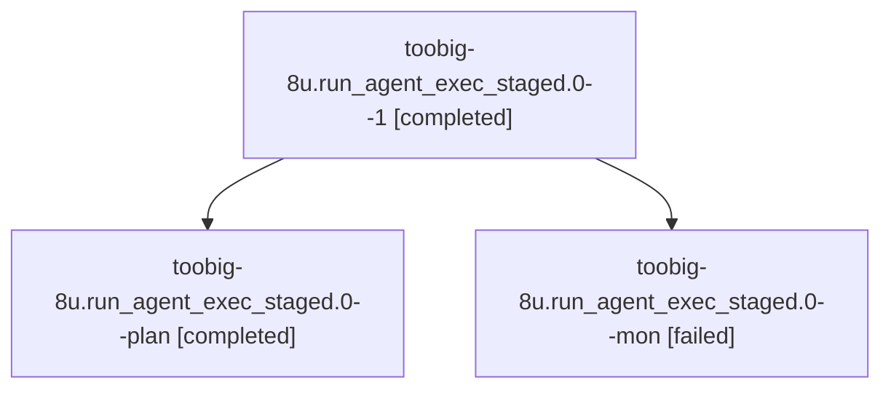

# Session: toobig-8u.run\_agent\_exec\_staged.0

[Agent Hoods](../README.md) / [bbugyi200](../users/bbugyi200/README.md) / [athena](../users/bbugyi200/machines/athena/README.md) / [toobig-8u](../users/bbugyi200/machines/athena/hoods/toobig-8u/README.md) / toobig-8u.run\_agent\_exec\_staged.0

Owner: `bbugyi200.athena` · Hood: `toobig-8u` · Members: 3

## Lineage

The diagram is an optional enhancement; the ordered table below contains the same lineage in accessible text.

| Role | Agent | State | Model / provider | Timing | Commits | Prompt | Chat |
|---|---|---|---|---|---:|---|---|
| 1 | toobig-8u.run\_agent\_exec\_staged.0--1 | completed | muse-spark-1.3-contributor / muse | 2026-10-30T06:31:15.721235+00:00 → 2026-10-30T06:42:19.422032+00:00 | [1](../agents/bbugyi200.athena.toobig-8u.run_agent_exec_staged.0--1/README.md#commits) | [Prompt](../agents/bbugyi200.athena.toobig-8u.run_agent_exec_staged.0--1/prompt.md) | [Chat](../agents/bbugyi200.athena.toobig-8u.run_agent_exec_staged.0--1/chat.md) |
| plan | toobig-8u.run\_agent\_exec\_staged.0--plan | completed | muse-spark-1.3-contributor / muse | 2026-10-30T04:48:55.388284+00:00 → 2026-10-30T05:26:17.519056+00:00 | 0 | [Prompt](../agents/bbugyi200.athena.toobig-8u.run_agent_exec_staged.0--plan/prompt.md) | [Chat](../agents/bbugyi200.athena.toobig-8u.run_agent_exec_staged.0--plan/chat.md) |
| mon | toobig-8u.run\_agent\_exec\_staged.0--mon | failed | muse-spark-1.3-contributor / muse | 2026-10-30T05:26:07.638959+00:00 → 2026-10-30T06:33:13.766307+00:00 | 0 | — | [Chat](../agents/bbugyi200.athena.toobig-8u.run_agent_exec_staged.0--mon/chat.md) |

## Commits

| Role | Repo | Commit | Subject | Committed |
|---|---|---|---|---|
| 1 | sase | [`3928f2f`](https://github.com/sase-org/sase/commit/3928f2f918c6e37b7553b52648b259efe0da8298) | refactor(axe): split run\_agent\_exec\_staged into focused modules | 2026-10-30 02:40:07 EDT |

## Neighbors

| Agent | Relation | State |
|---|---|---|
| [toobig-8u.agent\_list\_render\_rail.0](../agents/bbugyi200.athena.toobig-8u.agent_list_render_rail.0/README.md) | toobig-8u hood | completed |
| [toobig-8u.declaration.0](bbugyi200.athena.toobig-8u.declaration.0.md) (session · 5) | toobig-8u hood | completed 3, failed 2 |
| [toobig-8u.reclaim.0](bbugyi200.athena.toobig-8u.reclaim.0.md) (session · 7) | toobig-8u hood | active 1, completed 3, failed 3 |
| [toobig-8u.test\_rebase\_gate\_runner.0](../agents/bbugyi200.athena.toobig-8u.test_rebase_gate_runner.0/README.md) | toobig-8u hood | waiting |
| [toobig-8u.workspace\_handler\_maintenance.0](../agents/bbugyi200.athena.toobig-8u.workspace_handler_maintenance.0/README.md) | toobig-8u hood | waiting |
