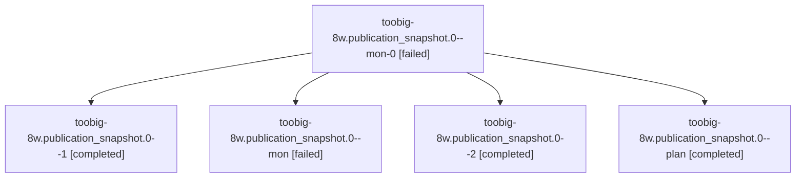

# Session: toobig-8w.publication\_snapshot.0

[Agent Hoods](../README.md) / [bbugyi200](../users/bbugyi200/README.md) / [athena](../users/bbugyi200/machines/athena/README.md) / [toobig-8w](../users/bbugyi200/machines/athena/hoods/toobig-8w/README.md) / toobig-8w.publication\_snapshot.0

Owner: `bbugyi200.athena` · Hood: `toobig-8w` · Members: 5

## Lineage

The diagram is an optional enhancement; the ordered table below contains the same lineage in accessible text.

| Role | Agent | State | Model / provider | Timing | Commits | Prompt | Chat |
|---|---|---|---|---|---:|---|---|
| mon-0 | toobig-8w.publication\_snapshot.0--mon-0 | failed | muse-spark-1.3-contributor / muse | 2026-10-30T19:44:14.884608+00:00 → 2026-10-30T19:50:54.663196+00:00 | 0 | — | [Chat](../agents/bbugyi200.athena.toobig-8w.publication_snapshot.0--mon-0/chat.md) |
| 1 | toobig-8w.publication\_snapshot.0--1 | completed | muse-spark-1.3-contributor / muse | 2026-10-30T19:25:05.988746+00:00 → 2026-10-30T19:44:27.960570+00:00 | 0 | [Prompt](../agents/bbugyi200.athena.toobig-8w.publication_snapshot.0--1/prompt.md) | [Chat](../agents/bbugyi200.athena.toobig-8w.publication_snapshot.0--1/chat.md) |
| mon | toobig-8w.publication\_snapshot.0--mon | failed | muse-spark-1.3-contributor / muse | 2026-10-30T18:28:35.630015+00:00 → 2026-10-30T19:23:04.661429+00:00 | 0 | — | [Chat](../agents/bbugyi200.athena.toobig-8w.publication_snapshot.0--mon/chat.md) |
| 2 | toobig-8w.publication\_snapshot.0--2 | completed | muse-spark-1.3-contributor / muse | 2026-10-30T19:56:17.194159+00:00 → 2026-10-30T20:01:12.684205+00:00 | [1](../agents/bbugyi200.athena.toobig-8w.publication_snapshot.0--2/README.md#commits) | [Prompt](../agents/bbugyi200.athena.toobig-8w.publication_snapshot.0--2/prompt.md) | [Chat](../agents/bbugyi200.athena.toobig-8w.publication_snapshot.0--2/chat.md) |
| plan | toobig-8w.publication\_snapshot.0--plan | completed | muse-spark-1.3-contributor / muse | 2026-10-30T18:10:11.267073+00:00 → 2026-10-30T18:28:46.850083+00:00 | 0 | [Prompt](../agents/bbugyi200.athena.toobig-8w.publication_snapshot.0--plan/prompt.md) | [Chat](../agents/bbugyi200.athena.toobig-8w.publication_snapshot.0--plan/chat.md) |

## Commits

| Role | Repo | Commit | Subject | Committed |
|---|---|---|---|---|
| 2 | sase | [`ee7bcdd`](https://github.com/sase-org/sase/commit/ee7bcddb6062f5e22b04a548de0c603f47628aae) | refactor(agents-sync): split publication\_snapshot into gated modules | 2026-10-30 16:01:02 EDT |

## Neighbors

| Agent | Relation | State |
|---|---|---|
| [toobig-8w.prompt\_artifact\_staging.0](../agents/bbugyi200.athena.toobig-8w.prompt_artifact_staging.0/README.md) | toobig-8w hood | waiting |
| [toobig-8w.publication\_protection.0](../agents/bbugyi200.athena.toobig-8w.publication_protection.0/README.md) | toobig-8w hood | completed |
| [toobig-8w.publication\_state\_repair.0](../agents/bbugyi200.athena.toobig-8w.publication_state_repair.0/README.md) | toobig-8w hood | completed |
| [toobig-8w.staged\_handoff.0](../agents/bbugyi200.athena.toobig-8w.staged_handoff.0/README.md) | toobig-8w hood | completed |
| [toobig-8w.start\_stage.0](../agents/bbugyi200.athena.toobig-8w.start_stage.0/README.md) | toobig-8w hood | waiting |
| [toobig-8w.test\_agents\_tab\_graph\_isolation.0](../agents/bbugyi200.athena.toobig-8w.test_agents_tab_graph_isolation.0/README.md) | toobig-8w hood | waiting |
| [toobig-8w.test\_cli.0](../agents/bbugyi200.athena.toobig-8w.test_cli.0/README.md) | toobig-8w hood | waiting |
| [toobig-8w.test\_commit\_publication\_queue.0](../agents/bbugyi200.athena.toobig-8w.test_commit_publication_queue.0/README.md) | toobig-8w hood | waiting |
| [toobig-8w.test\_publication\_state\_repair.0](../agents/bbugyi200.athena.toobig-8w.test_publication_state_repair.0/README.md) | toobig-8w hood | waiting |
| [toobig-8w.test\_workflow\_completion.0](../agents/bbugyi200.athena.toobig-8w.test_workflow_completion.0/README.md) | toobig-8w hood | waiting |
