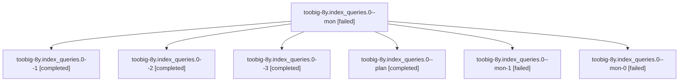

# Session: toobig-8y.index\_queries.0

[Agent Hoods](../README.md) / [bbugyi200](../users/bbugyi200/README.md) / [athena](../users/bbugyi200/machines/athena/README.md) / [toobig-8y](../users/bbugyi200/machines/athena/hoods/toobig-8y/README.md) / toobig-8y.index\_queries.0

Owner: `bbugyi200.athena` · Hood: `toobig-8y` · Members: 7

## Lineage

The diagram is an optional enhancement; the ordered table below contains the same lineage in accessible text.

| Role | Agent | State | Model / provider | Timing | Commits | Prompt | Chat |
|---|---|---|---|---|---:|---|---|
| mon | toobig-8y.index\_queries.0--mon | failed | grok-4.6 / grok | 2026-10-31T13:48:17.454419+00:00 → 2026-10-31T14:14:33.938930+00:00 | 0 | — | [Chat](../agents/bbugyi200.athena.toobig-8y.index_queries.0--mon/chat.md) |
| 1 | toobig-8y.index\_queries.0--1 | completed | grok-4.6 / grok | 2026-10-31T14:16:31.786078+00:00 → 2026-10-31T14:45:44.786997+00:00 | 0 | [Prompt](../agents/bbugyi200.athena.toobig-8y.index_queries.0--1/prompt.md) | [Chat](../agents/bbugyi200.athena.toobig-8y.index_queries.0--1/chat.md) |
| 2 | toobig-8y.index\_queries.0--2 | completed | grok-4.6 / grok | 2026-10-31T15:47:28.874063+00:00 → 2026-10-31T15:58:01.572926+00:00 | 0 | [Prompt](../agents/bbugyi200.athena.toobig-8y.index_queries.0--2/prompt.md) | [Chat](../agents/bbugyi200.athena.toobig-8y.index_queries.0--2/chat.md) |
| 3 | toobig-8y.index\_queries.0--3 | completed | grok-4.6 / grok | 2026-10-31T16:15:21.631229+00:00 → 2026-10-31T16:23:06.732832+00:00 | [1](../agents/bbugyi200.athena.toobig-8y.index_queries.0--3/README.md#commits) | [Prompt](../agents/bbugyi200.athena.toobig-8y.index_queries.0--3/prompt.md) | [Chat](../agents/bbugyi200.athena.toobig-8y.index_queries.0--3/chat.md) |
| plan | toobig-8y.index\_queries.0--plan | completed | grok-4.6 / grok | 2026-10-31T13:12:39.394243+00:00 → 2026-10-31T13:48:23.257765+00:00 | 0 | [Prompt](../agents/bbugyi200.athena.toobig-8y.index_queries.0--plan/prompt.md) | [Chat](../agents/bbugyi200.athena.toobig-8y.index_queries.0--plan/chat.md) |
| mon-1 | toobig-8y.index\_queries.0--mon-1 | failed | grok-4.6 / grok | 2026-10-31T15:57:41.514994+00:00 → 2026-10-31T16:12:00.056875+00:00 | 0 | — | [Chat](../agents/bbugyi200.athena.toobig-8y.index_queries.0--mon-1/chat.md) |
| mon-0 | toobig-8y.index\_queries.0--mon-0 | failed | grok-4.6 / grok | 2026-10-31T14:45:32.845340+00:00 → 2026-10-31T15:45:38.034008+00:00 | 0 | — | — |

## Commits

| Role | Repo | Commit | Subject | Committed |
|---|---|---|---|---|
| 3 | sase | [`2a5ccbf`](https://github.com/sase-org/sase/commit/2a5ccbf8f8d8fec1eae53a8deabdb019e68a6ca7) | refactor(wait): split wait-dependency index queries under the 500-line cap | 2026-10-31 12:22:48 EDT |

## Neighbors

| Agent | Relation | State |
|---|---|---|
| [toobig-8y.meta\_enrichment\_filesystem.0](../agents/bbugyi200.athena.toobig-8y.meta_enrichment_filesystem.0/README.md) | toobig-8y hood | completed |
| [toobig-8y.test\_agent\_chat\_from\_name\_agent\_session.0](../agents/bbugyi200.athena.toobig-8y.test_agent_chat_from_name_agent_session.0/README.md) | toobig-8y hood | waiting |
| [toobig-8y.test\_deck\_view\_main\_pilot.0](../agents/bbugyi200.athena.toobig-8y.test_deck_view_main_pilot.0/README.md) | toobig-8y hood | waiting |
