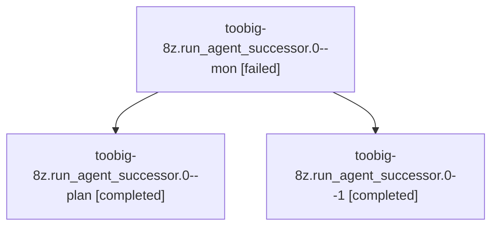

# Session: toobig-8z.run\_agent\_successor.0

[Agent Hoods](../README.md) / [bbugyi200](../users/bbugyi200/README.md) / [athena](../users/bbugyi200/machines/athena/README.md) / [toobig-8z](../users/bbugyi200/machines/athena/hoods/toobig-8z/README.md) / toobig-8z.run\_agent\_successor.0

Owner: `bbugyi200.athena` · Hood: `toobig-8z` · Members: 3

## Lineage

The diagram is an optional enhancement; the ordered table below contains the same lineage in accessible text.

| Role | Agent | State | Model / provider | Timing | Commits | Prompt | Chat |
|---|---|---|---|---|---:|---|---|
| mon | toobig-8z.run\_agent\_successor.0--mon | failed | muse-spark-1.3-contributor / muse | 2026-10-31T19:44:18.413143+00:00 → 2026-10-31T19:46:39.279817+00:00 | 0 | — | [Chat](../agents/bbugyi200.athena.toobig-8z.run_agent_successor.0--mon/chat.md) |
| plan | toobig-8z.run\_agent\_successor.0--plan | completed | muse-spark-1.3-contributor / muse | 2026-10-31T19:25:52.733961+00:00 → 2026-10-31T19:44:26.396928+00:00 | 0 | [Prompt](../agents/bbugyi200.athena.toobig-8z.run_agent_successor.0--plan/prompt.md) | [Chat](../agents/bbugyi200.athena.toobig-8z.run_agent_successor.0--plan/chat.md) |
| 1 | toobig-8z.run\_agent\_successor.0--1 | completed | muse-spark-1.3-contributor / muse | 2026-10-31T19:48:13.448307+00:00 → 2026-10-31T19:51:23.095752+00:00 | [1](../agents/bbugyi200.athena.toobig-8z.run_agent_successor.0--1/README.md#commits) | [Prompt](../agents/bbugyi200.athena.toobig-8z.run_agent_successor.0--1/prompt.md) | [Chat](../agents/bbugyi200.athena.toobig-8z.run_agent_successor.0--1/chat.md) |

## Commits

| Role | Repo | Commit | Subject | Committed |
|---|---|---|---|---|
| 1 | sase | [`e40e689`](https://github.com/sase-org/sase/commit/e40e68903effd67a7450bcfc324504d242764f75) | refactor(axe): split run\_agent\_successor into focused modules behind facade | 2026-10-31 15:51:13 EDT |

## Neighbors

| Agent | Relation | State |
|---|---|---|
| [toobig-8z.run\_agent\_exec\_pipe.0](../agents/bbugyi200.athena.toobig-8z.run_agent_exec_pipe.0/README.md) | toobig-8z hood | completed |
| [toobig-8z.start\_stage\_adopt.0](../agents/bbugyi200.athena.toobig-8z.start_stage_adopt.0/README.md) | toobig-8z hood | waiting |
| [toobig-8z.transaction.0](../agents/bbugyi200.athena.toobig-8z.transaction.0/README.md) | toobig-8z hood | completed |
