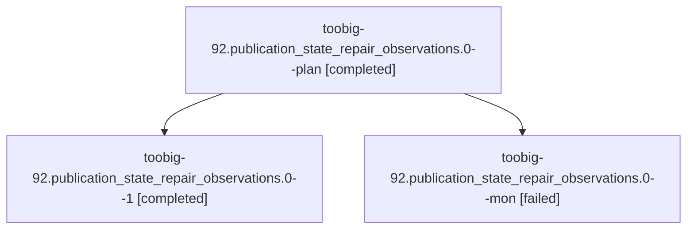

# Session: toobig-92.publication\_state\_repair\_observations.0

[Agent Hoods](../README.md) / [bbugyi200](../users/bbugyi200/README.md) / [athena](../users/bbugyi200/machines/athena/README.md) / [toobig-92](../users/bbugyi200/machines/athena/hoods/toobig-92/README.md) / toobig-92.publication\_state\_repair\_observations.0

Owner: `bbugyi200.athena` · Hood: `toobig-92` · Members: 3

## Lineage

The diagram is an optional enhancement; the ordered table below contains the same lineage in accessible text.

| Role | Agent | State | Model / provider | Timing | Commits | Prompt | Chat |
|---|---|---|---|---|---:|---|---|
| plan | toobig-92.publication\_state\_repair\_observations.0--plan | completed | muse-spark-1.3-contributor / muse | 2026-11-01T21:38:35.328449+00:00 → 2026-11-01T21:55:17.659257+00:00 | 0 | [Prompt](../agents/bbugyi200.athena.toobig-92.publication_state_repair_observations.0--plan/prompt.md) | [Chat](../agents/bbugyi200.athena.toobig-92.publication_state_repair_observations.0--plan/chat.md) |
| 1 | toobig-92.publication\_state\_repair\_observations.0--1 | completed | muse-spark-1.3-contributor / muse | 2026-11-01T22:58:10.441491+00:00 → 2026-11-01T23:02:38.049437+00:00 | [1](../agents/bbugyi200.athena.toobig-92.publication_state_repair_observations.0--1/README.md#commits) | [Prompt](../agents/bbugyi200.athena.toobig-92.publication_state_repair_observations.0--1/prompt.md) | [Chat](../agents/bbugyi200.athena.toobig-92.publication_state_repair_observations.0--1/chat.md) |
| mon | toobig-92.publication\_state\_repair\_observations.0--mon | failed | muse-spark-1.3-contributor / muse | 2026-11-01T21:55:06.235142+00:00 → 2026-11-01T22:56:50.742458+00:00 | 0 | — | [Chat](../agents/bbugyi200.athena.toobig-92.publication_state_repair_observations.0--mon/chat.md) |

## Commits

| Role | Repo | Commit | Subject | Committed |
|---|---|---|---|---|
| 1 | sase | [`9066546`](https://github.com/sase-org/sase/commit/9066546900ccafffcd3846f1ff56b81580c1f515) | refactor(agents-sync): split publication state repair observations into focused modules | 2026-11-01 18:02:27 EST |
