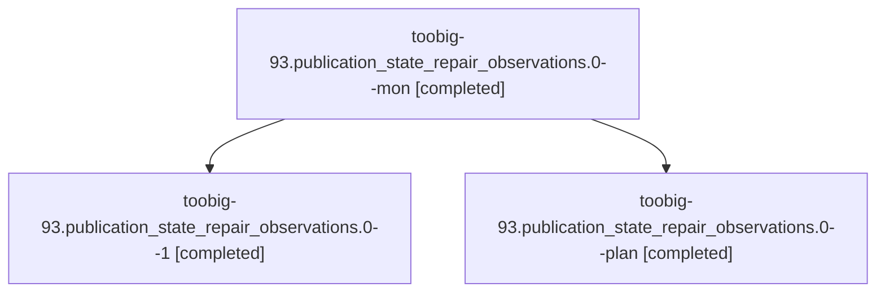

# Session: toobig-93.publication\_state\_repair\_observations.0

[Agent Hoods](../README.md) / [bbugyi200](../users/bbugyi200/README.md) / [athena](../users/bbugyi200/machines/athena/README.md) / [toobig-93](../users/bbugyi200/machines/athena/hoods/toobig-93/README.md) / toobig-93.publication\_state\_repair\_observations.0

Owner: `bbugyi200.athena` · Hood: `toobig-93` · Members: 3

## Lineage

The diagram is an optional enhancement; the ordered table below contains the same lineage in accessible text.

| Role | Agent | State | Model / provider | Timing | Commits | Prompt | Chat |
|---|---|---|---|---|---:|---|---|
| mon | toobig-93.publication\_state\_repair\_observations.0--mon | completed | muse-spark-1.3-contributor / muse | 2026-11-01T23:13:26.337380+00:00 → 2026-11-01T23:27:23.221580+00:00 | 0 | — | [Chat](../agents/bbugyi200.athena.toobig-93.publication_state_repair_observations.0--mon/chat.md) |
| 1 | toobig-93.publication\_state\_repair\_observations.0--1 | completed | muse-spark-1.3-contributor / muse | 2026-11-01T23:29:20.747836+00:00 → 2026-11-02T00:35:57.815574+00:00 | [1](../agents/bbugyi200.athena.toobig-93.publication_state_repair_observations.0--1/README.md#commits) | [Prompt](../agents/bbugyi200.athena.toobig-93.publication_state_repair_observations.0--1/prompt.md) | [Chat](../agents/bbugyi200.athena.toobig-93.publication_state_repair_observations.0--1/chat.md) |
| plan | toobig-93.publication\_state\_repair\_observations.0--plan | completed | muse-spark-1.3-contributor / muse | 2026-11-01T22:59:10.177970+00:00 → 2026-11-01T23:13:37.717568+00:00 | 0 | [Prompt](../agents/bbugyi200.athena.toobig-93.publication_state_repair_observations.0--plan/prompt.md) | [Chat](../agents/bbugyi200.athena.toobig-93.publication_state_repair_observations.0--plan/chat.md) |

## Commits

| Role | Repo | Commit | Subject | Committed |
|---|---|---|---|---|
| 1 | sase | [`82cf081`](https://github.com/sase-org/sase/commit/82cf081fc4cccccff9f46f28375fb420df277e07) | refactor(agents-sync): split publication\_state\_repair\_observations into focused modules | 2026-11-01 19:27:46 EST |
