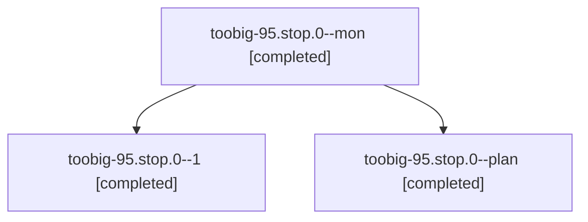

# Session: toobig-95.stop.0

[Agent Hoods](../README.md) / [bbugyi200](../users/bbugyi200/README.md) / [athena](../users/bbugyi200/machines/athena/README.md) / [toobig-95](../users/bbugyi200/machines/athena/hoods/toobig-95/README.md) / toobig-95.stop.0

Owner: `bbugyi200.athena` · Hood: `toobig-95` · Members: 3

## Lineage

The diagram is an optional enhancement; the ordered table below contains the same lineage in accessible text.

| Role | Agent | State | Model / provider | Timing | Commits | Prompt | Chat |
|---|---|---|---|---|---:|---|---|
| mon | toobig-95.stop.0--mon | completed | muse-spark-1.3-contributor / muse | 2026-11-03T13:02:54.026373+00:00 → 2026-11-03T13:08:54.421576+00:00 | 0 | — | [Chat](../agents/bbugyi200.athena.toobig-95.stop.0--mon/chat.md) |
| 1 | toobig-95.stop.0--1 | completed | muse-spark-1.3-contributor / muse | 2026-11-03T13:09:49.418537+00:00 → 2026-11-03T13:11:34.212767+00:00 | [1](../agents/bbugyi200.athena.toobig-95.stop.0--1/README.md#commits) | [Prompt](../agents/bbugyi200.athena.toobig-95.stop.0--1/prompt.md) | [Chat](../agents/bbugyi200.athena.toobig-95.stop.0--1/chat.md) |
| plan | toobig-95.stop.0--plan | completed | muse-spark-1.3-contributor / muse | 2026-11-03T12:36:16.595356+00:00 → 2026-11-03T13:07:23.240545+00:00 | 0 | [Prompt](../agents/bbugyi200.athena.toobig-95.stop.0--plan/prompt.md) | [Chat](../agents/bbugyi200.athena.toobig-95.stop.0--plan/chat.md) |

## Commits

| Role | Repo | Commit | Subject | Committed |
|---|---|---|---|---|
| 1 | sase | [`aa7eedb`](https://github.com/sase-org/sase/commit/aa7eedb1c51fa01d2fecddc78eeb34e061f634a5) | refactor(hijack): split stop.py into facade plus five focused modules | 2026-11-03 08:11:24 EST |

## Neighbors

| Agent | Relation | State |
|---|---|---|
| [toobig-95.readout.0](../agents/bbugyi200.athena.toobig-95.readout.0/README.md) | toobig-95 hood | waiting |
| [toobig-95.run\_agent\_runner\_lifecycle.0](../agents/bbugyi200.athena.toobig-95.run_agent_runner_lifecycle.0/README.md) | toobig-95 hood | active |
| [toobig-95.test\_monitor\_handler\_start\_launch.0](../agents/bbugyi200.athena.toobig-95.test_monitor_handler_start_launch.0/README.md) | toobig-95 hood | waiting |
| [toobig-95.test\_readout.0](../agents/bbugyi200.athena.toobig-95.test_readout.0/README.md) | toobig-95 hood | waiting |
| [toobig-95.test\_workspace\_retention.0](../agents/bbugyi200.athena.toobig-95.test_workspace_retention.0/README.md) | toobig-95 hood | waiting |
