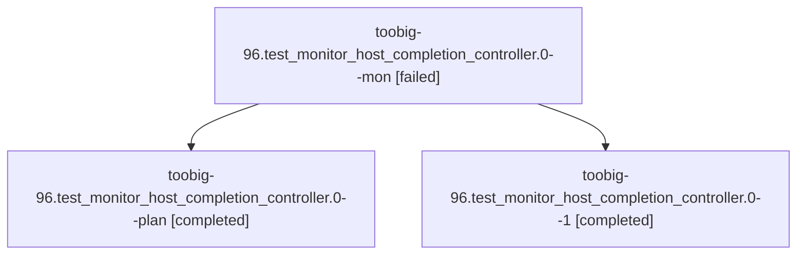

# Session: toobig-96.test\_monitor\_host\_completion\_controller.0

[Agent Hoods](../README.md) / [bbugyi200](../users/bbugyi200/README.md) / [athena](../users/bbugyi200/machines/athena/README.md) / [toobig-96](../users/bbugyi200/machines/athena/hoods/toobig-96/README.md) / toobig-96.test\_monitor\_host\_completion\_controller.0

Owner: `bbugyi200.athena` · Hood: `toobig-96` · Members: 3

## Lineage

The diagram is an optional enhancement; the ordered table below contains the same lineage in accessible text.

| Role | Agent | State | Model / provider | Timing | Commits | Prompt | Chat |
|---|---|---|---|---|---:|---|---|
| mon | toobig-96.test\_monitor\_host\_completion\_controller.0--mon | failed | muse-spark-1.3-contributor / muse | 2026-11-03T20:20:09.908344+00:00 → 2026-11-03T20:32:07.140270+00:00 | 0 | — | — |
| plan | toobig-96.test\_monitor\_host\_completion\_controller.0--plan | completed | muse-spark-1.3-contributor / muse | 2026-11-03T19:54:46.232142+00:00 → 2026-11-03T20:30:14.558144+00:00 | 0 | [Prompt](../agents/bbugyi200.athena.toobig-96.test_monitor_host_completion_controller.0--plan/prompt.md) | [Chat](../agents/bbugyi200.athena.toobig-96.test_monitor_host_completion_controller.0--plan/chat.md) |
| 1 | toobig-96.test\_monitor\_host\_completion\_controller.0--1 | completed | muse-spark-1.3-contributor / muse | 2026-11-03T20:33:23.566678+00:00 → 2026-11-03T20:35:38.985873+00:00 | [1](../agents/bbugyi200.athena.toobig-96.test_monitor_host_completion_controller.0--1/README.md#commits) | [Prompt](../agents/bbugyi200.athena.toobig-96.test_monitor_host_completion_controller.0--1/prompt.md) | [Chat](../agents/bbugyi200.athena.toobig-96.test_monitor_host_completion_controller.0--1/chat.md) |

## Commits

| Role | Repo | Commit | Subject | Committed |
|---|---|---|---|---|
| 1 | sase | [`f84da95`](https://github.com/sase-org/sase/commit/f84da953e421a878800950f62a1e40ed4baa7d8e) | test(monitor): split host completion controller tests into focused modules | 2026-11-03 15:35:28 EST |

## Neighbors

| Agent | Relation | State |
|---|---|---|
| [toobig-96.test\_finalizers\_prepared\_bridge.0](../agents/bbugyi200.athena.toobig-96.test_finalizers_prepared_bridge.0/README.md) | toobig-96 hood | active |
