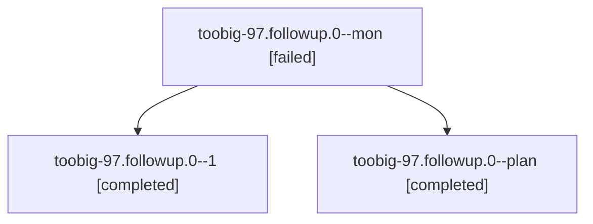

# Session: toobig-97.followup.0

[Agent Hoods](../README.md) / [bbugyi200](../users/bbugyi200/README.md) / [athena](../users/bbugyi200/machines/athena/README.md) / [toobig-97](../users/bbugyi200/machines/athena/hoods/toobig-97/README.md) / toobig-97.followup.0

Owner: `bbugyi200.athena` · Hood: `toobig-97` · Members: 3

## Lineage

The diagram is an optional enhancement; the ordered table below contains the same lineage in accessible text.

| Role | Agent | State | Model / provider | Timing | Commits | Prompt | Chat |
|---|---|---|---|---|---:|---|---|
| mon | toobig-97.followup.0--mon | failed | muse-spark-1.3-contributor / muse | 2026-11-04T00:41:56.751178+00:00 → 2026-11-04T00:51:07.145269+00:00 | 0 | — | [Chat](../agents/bbugyi200.athena.toobig-97.followup.0--mon/chat.md) |
| 1 | toobig-97.followup.0--1 | completed | muse-spark-1.3-contributor / muse | 2026-11-04T00:52:10.921842+00:00 → 2026-11-04T00:59:07.335456+00:00 | [1](../agents/bbugyi200.athena.toobig-97.followup.0--1/README.md#commits) | [Prompt](../agents/bbugyi200.athena.toobig-97.followup.0--1/prompt.md) | [Chat](../agents/bbugyi200.athena.toobig-97.followup.0--1/chat.md) |
| plan | toobig-97.followup.0--plan | completed | muse-spark-1.3-contributor / muse | 2026-11-04T00:14:05.926937+00:00 → 2026-11-04T00:49:10.790380+00:00 | 0 | [Prompt](../agents/bbugyi200.athena.toobig-97.followup.0--plan/prompt.md) | [Chat](../agents/bbugyi200.athena.toobig-97.followup.0--plan/chat.md) |

## Commits

| Role | Repo | Commit | Subject | Committed |
|---|---|---|---|---|
| 1 | sase | [`b8d88ad`](https://github.com/sase-org/sase/commit/b8d88adfdddd5a6108051e995a6a599ff945c020) | refactor(turns): split followup.py into focused modules | 2026-11-03 19:58:56 EST |
