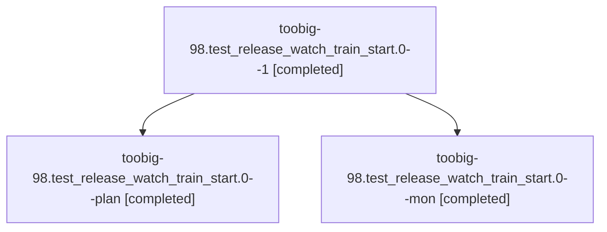

# Session: toobig-98.test\_release\_watch\_train\_start.0

[Agent Hoods](../README.md) / [bbugyi200](../users/bbugyi200/README.md) / [athena](../users/bbugyi200/machines/athena/README.md) / [toobig-98](../users/bbugyi200/machines/athena/hoods/toobig-98/README.md) / toobig-98.test\_release\_watch\_train\_start.0

Owner: `bbugyi200.athena` · Hood: `toobig-98` · Members: 3

## Lineage

The diagram is an optional enhancement; the ordered table below contains the same lineage in accessible text.

| Role | Agent | State | Model / provider | Timing | Commits | Prompt | Chat |
|---|---|---|---|---|---:|---|---|
| 1 | toobig-98.test\_release\_watch\_train\_start.0--1 | completed | muse-spark-1.3-contributor / muse | 2026-11-04T13:16:52.887718+00:00 → 2026-11-04T13:19:09.046244+00:00 | [1](../agents/bbugyi200.athena.toobig-98.test_release_watch_train_start.0--1/README.md#commits) | [Prompt](../agents/bbugyi200.athena.toobig-98.test_release_watch_train_start.0--1/prompt.md) | [Chat](../agents/bbugyi200.athena.toobig-98.test_release_watch_train_start.0--1/chat.md) |
| plan | toobig-98.test\_release\_watch\_train\_start.0--plan | completed | muse-spark-1.3-contributor / muse | 2026-11-04T12:17:37.354821+00:00 → 2026-11-04T13:13:29.434914+00:00 | 0 | [Prompt](../agents/bbugyi200.athena.toobig-98.test_release_watch_train_start.0--plan/prompt.md) | [Chat](../agents/bbugyi200.athena.toobig-98.test_release_watch_train_start.0--plan/chat.md) |
| mon | toobig-98.test\_release\_watch\_train\_start.0--mon | completed | muse-spark-1.3-contributor / muse | 2026-11-04T13:01:49.854308+00:00 → 2026-11-04T13:15:48.095990+00:00 | 0 | — | [Chat](../agents/bbugyi200.athena.toobig-98.test_release_watch_train_start.0--mon/chat.md) |

## Commits

| Role | Repo | Commit | Subject | Committed |
|---|---|---|---|---|
| 1 | sase | [`a3deb10`](https://github.com/sase-org/sase/commit/a3deb1020f2a3ce51c7ebe72bc3f33120a556e67) | test(toobig): split test\_release\_watch\_train\_start into focused modules | 2026-11-04 08:18:57 EST |
