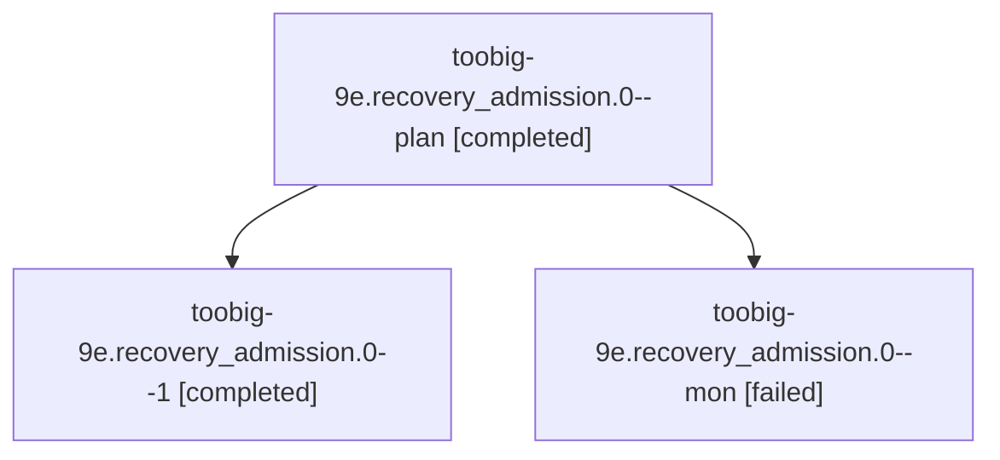

# Session: toobig-9e.recovery\_admission.0

[Agent Hoods](../README.md) / [bbugyi200](../users/bbugyi200/README.md) / [athena](../users/bbugyi200/machines/athena/README.md) / [toobig-9e](../users/bbugyi200/machines/athena/hoods/toobig-9e/README.md) / toobig-9e.recovery\_admission.0

Owner: `bbugyi200.athena` · Hood: `toobig-9e` · Members: 3

## Lineage

The diagram is an optional enhancement; the ordered table below contains the same lineage in accessible text.

| Role | Agent | State | Model / provider | Timing | Commits | Prompt | Chat |
|---|---|---|---|---|---:|---|---|
| plan | toobig-9e.recovery\_admission.0--plan | completed | muse-spark-1.3-contributor / muse | 2026-11-05T23:00:19.112076+00:00 → 2026-11-05T23:36:39.011245+00:00 | 0 | [Prompt](../agents/bbugyi200.athena.toobig-9e.recovery_admission.0--plan/prompt.md) | [Chat](../agents/bbugyi200.athena.toobig-9e.recovery_admission.0--plan/chat.md) |
| 1 | toobig-9e.recovery\_admission.0--1 | completed | muse-spark-1.3-contributor / muse | 2026-11-05T23:41:22.431834+00:00 → 2026-11-05T23:49:11.069119+00:00 | [1](../agents/bbugyi200.athena.toobig-9e.recovery_admission.0--1/README.md#commits) | [Prompt](../agents/bbugyi200.athena.toobig-9e.recovery_admission.0--1/prompt.md) | [Chat](../agents/bbugyi200.athena.toobig-9e.recovery_admission.0--1/chat.md) |
| mon | toobig-9e.recovery\_admission.0--mon | failed | muse-spark-1.3-contributor / muse | 2026-11-05T23:28:02.518328+00:00 → 2026-11-05T23:39:15.448342+00:00 | 0 | — | [Chat](../agents/bbugyi200.athena.toobig-9e.recovery_admission.0--mon/chat.md) |

## Commits

| Role | Repo | Commit | Subject | Committed |
|---|---|---|---|---|
| 1 | sase | [`bda79a8`](https://github.com/sase-org/sase/commit/bda79a8e259c27039716a6d5b5f6317857347398) | refactor(hijack): split recovery\_admission into modules under 500 lines | 2026-11-05 18:48:59 EST |

## Neighbors

| Agent | Relation | State |
|---|---|---|
| [toobig-9e.recover.0](../agents/bbugyi200.athena.toobig-9e.recover.0/README.md) | toobig-9e hood | completed |
| [toobig-9e.recovery\_successor.0](../agents/bbugyi200.athena.toobig-9e.recovery_successor.0/README.md) | toobig-9e hood | completed |
| [toobig-9e.test\_recovery\_bootstrap.0](../agents/bbugyi200.athena.toobig-9e.test_recovery_bootstrap.0/README.md) | toobig-9e hood | completed |
