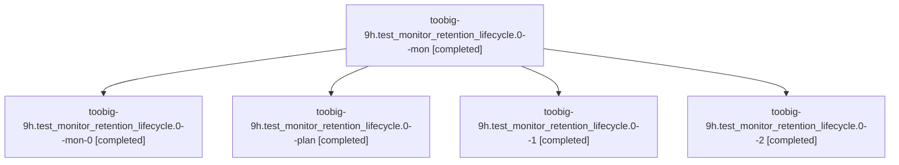

# Session: toobig-9h.test\_monitor\_retention\_lifecycle.0

[Agent Hoods](../README.md) / [bbugyi200](../users/bbugyi200/README.md) / [athena](../users/bbugyi200/machines/athena/README.md) / [toobig-9h](../users/bbugyi200/machines/athena/hoods/toobig-9h/README.md) / toobig-9h.test\_monitor\_retention\_lifecycle.0

Owner: `bbugyi200.athena` · Hood: `toobig-9h` · Members: 5

## Lineage

The diagram is an optional enhancement; the ordered table below contains the same lineage in accessible text.

| Role | Agent | State | Model / provider | Timing | Commits | Prompt | Chat |
|---|---|---|---|---|---:|---|---|
| mon | toobig-9h.test\_monitor\_retention\_lifecycle.0--mon | completed | muse-spark-1.3-contributor / muse | 2026-11-06T13:54:59.443084+00:00 → 2026-11-06T15:14:40.079523+00:00 | 0 | — | [Chat](../agents/bbugyi200.athena.toobig-9h.test_monitor_retention_lifecycle.0--mon/chat.md) |
| mon-0 | toobig-9h.test\_monitor\_retention\_lifecycle.0--mon-0 | completed | muse-spark-1.3-contributor / muse | 2026-11-06T15:25:35.990136+00:00 → 2026-11-06T15:32:11.167495+00:00 | 0 | — | [Chat](../agents/bbugyi200.athena.toobig-9h.test_monitor_retention_lifecycle.0--mon-0/chat.md) |
| plan | toobig-9h.test\_monitor\_retention\_lifecycle.0--plan | completed | muse-spark-1.3-contributor / muse | 2026-11-06T13:30:02.467924+00:00 → 2026-11-06T15:11:40.164903+00:00 | 0 | [Prompt](../agents/bbugyi200.athena.toobig-9h.test_monitor_retention_lifecycle.0--plan/prompt.md) | [Chat](../agents/bbugyi200.athena.toobig-9h.test_monitor_retention_lifecycle.0--plan/chat.md) |
| 1 | toobig-9h.test\_monitor\_retention\_lifecycle.0--1 | completed | muse-spark-1.3-contributor / muse | 2026-11-06T15:16:25.215009+00:00 → 2026-11-06T15:29:41.901937+00:00 | 0 | [Prompt](../agents/bbugyi200.athena.toobig-9h.test_monitor_retention_lifecycle.0--1/prompt.md) | [Chat](../agents/bbugyi200.athena.toobig-9h.test_monitor_retention_lifecycle.0--1/chat.md) |
| 2 | toobig-9h.test\_monitor\_retention\_lifecycle.0--2 | completed | muse-spark-1.3-contributor / muse | 2026-11-06T15:34:18.560913+00:00 → 2026-11-06T15:36:40.559206+00:00 | [1](../agents/bbugyi200.athena.toobig-9h.test_monitor_retention_lifecycle.0--2/README.md#commits) | [Prompt](../agents/bbugyi200.athena.toobig-9h.test_monitor_retention_lifecycle.0--2/prompt.md) | [Chat](../agents/bbugyi200.athena.toobig-9h.test_monitor_retention_lifecycle.0--2/chat.md) |

## Commits

| Role | Repo | Commit | Subject | Committed |
|---|---|---|---|---|
| 2 | sase | [`b5ea62a`](https://github.com/sase-org/sase/commit/b5ea62a0a2634ee03e9b1c646a996b499ba35102) | test(monitor): split retention lifecycle tests into focused modules | 2026-11-06 10:36:28 EST |

## Neighbors

| Agent | Relation | State |
|---|---|---|
| [toobig-9h.test\_detach.0](../agents/bbugyi200.athena.toobig-9h.test_detach.0/README.md) | toobig-9h hood | completed |
