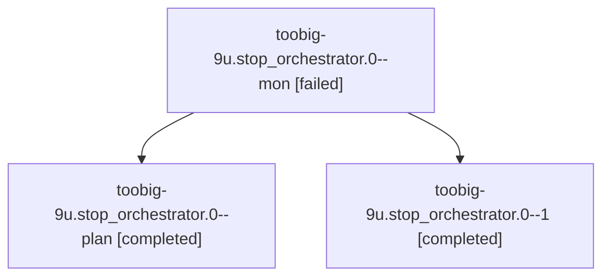

# Session: toobig-9u.stop\_orchestrator.0

[Agent Hoods](../README.md) / [bbugyi200](../users/bbugyi200/README.md) / [athena](../users/bbugyi200/machines/athena/README.md) / [toobig-9u](../users/bbugyi200/machines/athena/hoods/toobig-9u/README.md) / toobig-9u.stop\_orchestrator.0

Owner: `bbugyi200.athena` · Hood: `toobig-9u` · Members: 3

## Lineage

The diagram is an optional enhancement; the ordered table below contains the same lineage in accessible text.

| Role | Agent | State | Model / provider | Timing | Commits | Prompt | Chat |
|---|---|---|---|---|---:|---|---|
| mon | toobig-9u.stop\_orchestrator.0--mon | failed | muse-spark-1.3-contributor / muse | 2026-11-16T13:16:33.749385+00:00 → 2026-11-16T13:38:15.150537+00:00 | 0 | — | [Chat](../agents/bbugyi200.athena.toobig-9u.stop_orchestrator.0--mon/chat.md) |
| plan | toobig-9u.stop\_orchestrator.0--plan | completed | muse-spark-1.3-contributor / muse | 2026-11-16T12:44:12.979071+00:00 → 2026-11-16T13:36:22.344590+00:00 | 0 | [Prompt](../agents/bbugyi200.athena.toobig-9u.stop_orchestrator.0--plan/prompt.md) | [Chat](../agents/bbugyi200.athena.toobig-9u.stop_orchestrator.0--plan/chat.md) |
| 1 | toobig-9u.stop\_orchestrator.0--1 | completed | muse-spark-1.3-contributor / muse | 2026-11-16T13:48:22.910213+00:00 → 2026-11-16T13:53:50.454098+00:00 | [1](../agents/bbugyi200.athena.toobig-9u.stop_orchestrator.0--1/README.md#commits) | [Prompt](../agents/bbugyi200.athena.toobig-9u.stop_orchestrator.0--1/prompt.md) | [Chat](../agents/bbugyi200.athena.toobig-9u.stop_orchestrator.0--1/chat.md) |

## Commits

| Role | Repo | Commit | Subject | Committed |
|---|---|---|---|---|
| 1 | sase | [`00d01b4`](https://github.com/sase-org/sase/commit/00d01b4f9d5d3919246adce75f6fed509da31ddb) | refactor(agent-hijack): split \_stop\_orchestrator under the 500-line cap | 2026-11-16 08:53:26 EST |

## Neighbors

| Agent | Relation | State |
|---|---|---|
| [toobig-9u.stale\_running\_sweep.0](../agents/bbugyi200.athena.toobig-9u.stale_running_sweep.0/README.md) | toobig-9u hood | completed |
| [toobig-9u.test\_agent\_hijack\_canary.0](../agents/bbugyi200.athena.toobig-9u.test_agent_hijack_canary.0/README.md) | toobig-9u hood | completed |
