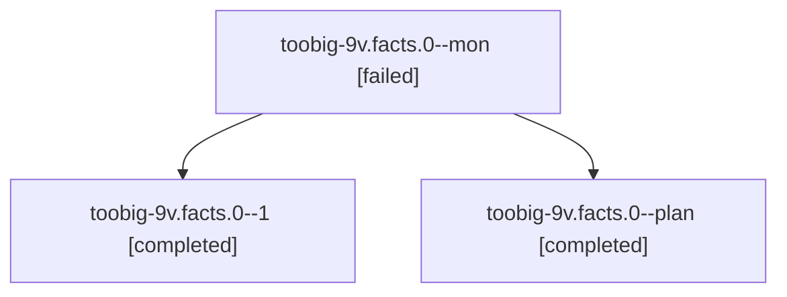

# Session: toobig-9v.facts.0

[Agent Hoods](../README.md) / [bbugyi200](../users/bbugyi200/README.md) / [athena](../users/bbugyi200/machines/athena/README.md) / [toobig-9v](../users/bbugyi200/machines/athena/hoods/toobig-9v/README.md) / toobig-9v.facts.0

Owner: `bbugyi200.athena` · Hood: `toobig-9v` · Members: 3

## Lineage

The diagram is an optional enhancement; the ordered table below contains the same lineage in accessible text.

| Role | Agent | State | Model / provider | Timing | Commits | Prompt | Chat |
|---|---|---|---|---|---:|---|---|
| mon | toobig-9v.facts.0--mon | failed | muse-spark-1.3-contributor / muse | 2026-11-16T18:20:00.895986+00:00 → 2026-11-16T19:27:32.718081+00:00 | 0 | — | [Chat](../agents/bbugyi200.athena.toobig-9v.facts.0--mon/chat.md) |
| 1 | toobig-9v.facts.0--1 | completed | muse-spark-1.3-contributor / muse | 2026-11-16T19:29:58.719786+00:00 → 2026-11-16T19:37:15.159586+00:00 | [1](../agents/bbugyi200.athena.toobig-9v.facts.0--1/README.md#commits) | [Prompt](../agents/bbugyi200.athena.toobig-9v.facts.0--1/prompt.md) | [Chat](../agents/bbugyi200.athena.toobig-9v.facts.0--1/chat.md) |
| plan | toobig-9v.facts.0--plan | completed | muse-spark-1.3-contributor / muse | 2026-11-16T17:30:53.319451+00:00 → 2026-11-16T19:25:52.848715+00:00 | 0 | [Prompt](../agents/bbugyi200.athena.toobig-9v.facts.0--plan/prompt.md) | [Chat](../agents/bbugyi200.athena.toobig-9v.facts.0--plan/chat.md) |

## Commits

| Role | Repo | Commit | Subject | Committed |
|---|---|---|---|---|
| 1 | sase | [`b586776`](https://github.com/sase-org/sase/commit/b586776bf3dd6cd433c2fdccbe451664b4af6cd4) | refactor(hijack): split facts.py into facade plus \_facts\_common and \_facts\_resolve | 2026-11-16 14:36:58 EST |

## Neighbors

| Agent | Relation | State |
|---|---|---|
| [toobig-9v.latch.0](../agents/bbugyi200.athena.toobig-9v.latch.0/README.md) | toobig-9v hood | completed |
| [toobig-9v.local\_trust\_enforcement.0](../agents/bbugyi200.athena.toobig-9v.local_trust_enforcement.0/README.md) | toobig-9v hood | waiting |
| [toobig-9v.local\_trust\_management.0](../agents/bbugyi200.athena.toobig-9v.local_trust_management.0/README.md) | toobig-9v hood | waiting |
| [toobig-9v.run\_agent\_exec\_staged\_dispatch.0](../agents/bbugyi200.athena.toobig-9v.run_agent_exec_staged_dispatch.0/README.md) | toobig-9v hood | waiting |
