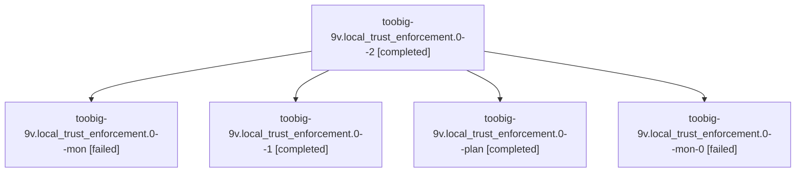

# Session: toobig-9v.local\_trust\_enforcement.0

[Agent Hoods](../README.md) / [bbugyi200](../users/bbugyi200/README.md) / [athena](../users/bbugyi200/machines/athena/README.md) / [toobig-9v](../users/bbugyi200/machines/athena/hoods/toobig-9v/README.md) / toobig-9v.local\_trust\_enforcement.0

Owner: `bbugyi200.athena` · Hood: `toobig-9v` · Members: 5

## Lineage

The diagram is an optional enhancement; the ordered table below contains the same lineage in accessible text.

| Role | Agent | State | Model / provider | Timing | Commits | Prompt | Chat |
|---|---|---|---|---|---:|---|---|
| 2 | toobig-9v.local\_trust\_enforcement.0--2 | completed | muse-spark-1.3-contributor / muse | 2026-11-16T23:18:35.671439+00:00 → 2026-11-16T23:21:55.797866+00:00 | [1](../agents/bbugyi200.athena.toobig-9v.local_trust_enforcement.0--2/README.md#commits) | [Prompt](../agents/bbugyi200.athena.toobig-9v.local_trust_enforcement.0--2/prompt.md) | [Chat](../agents/bbugyi200.athena.toobig-9v.local_trust_enforcement.0--2/chat.md) |
| mon | toobig-9v.local\_trust\_enforcement.0--mon | failed | muse-spark-1.3-contributor / muse | 2026-11-16T22:36:50.852528+00:00 → 2026-11-16T22:40:06.996033+00:00 | 0 | — | [Chat](../agents/bbugyi200.athena.toobig-9v.local_trust_enforcement.0--mon/chat.md) |
| 1 | toobig-9v.local\_trust\_enforcement.0--1 | completed | muse-spark-1.3-contributor / muse | 2026-11-16T22:40:41.006857+00:00 → 2026-11-16T22:53:51.675133+00:00 | 0 | [Prompt](../agents/bbugyi200.athena.toobig-9v.local_trust_enforcement.0--1/prompt.md) | [Chat](../agents/bbugyi200.athena.toobig-9v.local_trust_enforcement.0--1/chat.md) |
| plan | toobig-9v.local\_trust\_enforcement.0--plan | completed | muse-spark-1.3-contributor / muse | 2026-11-16T21:49:33.755513+00:00 → 2026-11-16T22:38:14.599027+00:00 | 0 | [Prompt](../agents/bbugyi200.athena.toobig-9v.local_trust_enforcement.0--plan/prompt.md) | [Chat](../agents/bbugyi200.athena.toobig-9v.local_trust_enforcement.0--plan/chat.md) |
| mon-0 | toobig-9v.local\_trust\_enforcement.0--mon-0 | failed | muse-spark-1.3-contributor / muse | 2026-11-16T22:51:49.764872+00:00 → 2026-11-16T23:18:05.664835+00:00 | 0 | — | [Chat](../agents/bbugyi200.athena.toobig-9v.local_trust_enforcement.0--mon-0/chat.md) |

## Commits

| Role | Repo | Commit | Subject | Committed |
|---|---|---|---|---|
| 2 | sase | [`e3f6d30`](https://github.com/sase-org/sase/commit/e3f6d302db2918a07d4b6d68025fc3a66543a2d3) | refactor(config): split local\_trust\_enforcement into facade plus shared, evaluation, and flag\_on modules | 2026-11-16 18:21:42 EST |

## Neighbors

| Agent | Relation | State |
|---|---|---|
| [toobig-9v.facts.0](bbugyi200.athena.toobig-9v.facts.0.md) (session · 3) | toobig-9v hood | completed 2, failed 1 |
| [toobig-9v.latch.0](../agents/bbugyi200.athena.toobig-9v.latch.0/README.md) | toobig-9v hood | completed |
| [toobig-9v.local\_trust\_management.0](../agents/bbugyi200.athena.toobig-9v.local_trust_management.0/README.md) | toobig-9v hood | completed |
| [toobig-9v.run\_agent\_exec\_staged\_dispatch.0](../agents/bbugyi200.athena.toobig-9v.run_agent_exec_staged_dispatch.0/README.md) | toobig-9v hood | completed |
