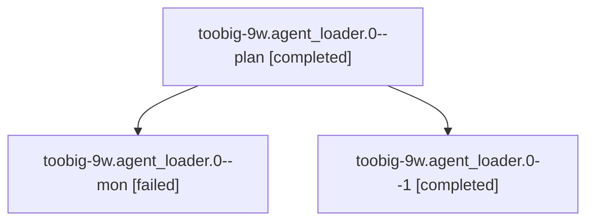

# Session: toobig-9w.agent\_loader.0

[Agent Hoods](../README.md) / [bbugyi200](../users/bbugyi200/README.md) / [athena](../users/bbugyi200/machines/athena/README.md) / [toobig-9w](../users/bbugyi200/machines/athena/hoods/toobig-9w/README.md) / toobig-9w.agent\_loader.0

Owner: `bbugyi200.athena` · Hood: `toobig-9w` · Members: 3

## Lineage

The diagram is an optional enhancement; the ordered table below contains the same lineage in accessible text.

| Role | Agent | State | Model / provider | Timing | Commits | Prompt | Chat |
|---|---|---|---|---|---:|---|---|
| plan | toobig-9w.agent\_loader.0--plan | completed | muse-spark-1.3-contributor / muse | 2026-11-17T00:41:18.849539+00:00 → 2026-11-17T02:01:02.110249+00:00 | 0 | [Prompt](../agents/bbugyi200.athena.toobig-9w.agent_loader.0--plan/prompt.md) | [Chat](../agents/bbugyi200.athena.toobig-9w.agent_loader.0--plan/chat.md) |
| mon | toobig-9w.agent\_loader.0--mon | failed | muse-spark-1.3-contributor / muse | 2026-11-17T01:59:37.586535+00:00 → 2026-11-17T02:03:47.323523+00:00 | 0 | — | [Chat](../agents/bbugyi200.athena.toobig-9w.agent_loader.0--mon/chat.md) |
| 1 | toobig-9w.agent\_loader.0--1 | completed | muse-spark-1.3-contributor / muse | 2026-11-17T02:04:20.132611+00:00 → 2026-11-17T02:24:10.016064+00:00 | [1](../agents/bbugyi200.athena.toobig-9w.agent_loader.0--1/README.md#commits) | [Prompt](../agents/bbugyi200.athena.toobig-9w.agent_loader.0--1/prompt.md) | [Chat](../agents/bbugyi200.athena.toobig-9w.agent_loader.0--1/chat.md) |

## Commits

| Role | Repo | Commit | Subject | Committed |
|---|---|---|---|---|
| 1 | sase | [`2751f5a`](https://github.com/sase-org/sase/commit/2751f5ad1f87eff70ccf58ea1329d20321a1490d) | refactor(agent-loader): decompose oversized module into focused units | 2026-11-16 21:23:55 EST |

## Neighbors

| Agent | Relation | State |
|---|---|---|
| [toobig-9w.git\_commit\_dispatch.0](../agents/bbugyi200.athena.toobig-9w.git_commit_dispatch.0/README.md) | toobig-9w hood | waiting |
| [toobig-9w.settlement.0](../agents/bbugyi200.athena.toobig-9w.settlement.0/README.md) | toobig-9w hood | waiting |
| [toobig-9w.stop\_orchestrator\_main.0](../agents/bbugyi200.athena.toobig-9w.stop_orchestrator_main.0/README.md) | toobig-9w hood | active |
| [toobig-9w.supervise.0](../agents/bbugyi200.athena.toobig-9w.supervise.0/README.md) | toobig-9w hood | waiting |
| [toobig-9w.test\_agent\_hijack\_action.0](../agents/bbugyi200.athena.toobig-9w.test_agent_hijack_action.0/README.md) | toobig-9w hood | waiting |
| [toobig-9w.test\_agent\_hijack\_latch.0](../agents/bbugyi200.athena.toobig-9w.test_agent_hijack_latch.0/README.md) | toobig-9w hood | waiting |
| [toobig-9w.test\_agent\_hijack\_stop.0](../agents/bbugyi200.athena.toobig-9w.test_agent_hijack_stop.0/README.md) | toobig-9w hood | waiting |
| [toobig-9w.test\_new\_project\_create\_execution.0](../agents/bbugyi200.athena.toobig-9w.test_new_project_create_execution.0/README.md) | toobig-9w hood | waiting |
