# Session: toobig-9x.test\_artifacts\_post\_paint\_publication.0

[Agent Hoods](../README.md) / [bbugyi200](../users/bbugyi200/README.md) / [athena](../users/bbugyi200/machines/athena/README.md) / [toobig-9x](../users/bbugyi200/machines/athena/hoods/toobig-9x/README.md) / toobig-9x.test\_artifacts\_post\_paint\_publication.0

Owner: `bbugyi200.athena` · Hood: `toobig-9x` · Members: 3

## Lineage

```mermaid
flowchart TD
  n0["toobig-9x.test_artifacts_post_paint_publication.0--1 [completed]"]
  n1["toobig-9x.test_artifacts_post_paint_publication.0--plan [completed]"]
  n0 --> n1
  n2["toobig-9x.test_artifacts_post_paint_publication.0--mon [failed]"]
  n0 --> n2
```

The diagram is an optional enhancement; the ordered table below contains the same lineage in accessible text.

| Role | Agent | State | Model / provider | Timing | Commits | Prompt | Chat |
|---|---|---|---|---|---:|---|---|
| 1 | toobig-9x.test\_artifacts\_post\_paint\_publication.0--1 | completed | muse-spark-1.3-contributor / muse | 2026-11-17T08:49:40.292931+00:00 → 2026-11-17T08:52:16.369212+00:00 | [1](../agents/bbugyi200.athena.toobig-9x.test_artifacts_post_paint_publication.0--1/README.md#commits) | [Prompt](../agents/bbugyi200.athena.toobig-9x.test_artifacts_post_paint_publication.0--1/prompt.md) | [Chat](../agents/bbugyi200.athena.toobig-9x.test_artifacts_post_paint_publication.0--1/chat.md) |
| plan | toobig-9x.test\_artifacts\_post\_paint\_publication.0--plan | completed | muse-spark-1.3-contributor / muse | 2026-11-17T08:18:31.817998+00:00 → 2026-11-17T08:38:37.995918+00:00 | 0 | [Prompt](../agents/bbugyi200.athena.toobig-9x.test_artifacts_post_paint_publication.0--plan/prompt.md) | [Chat](../agents/bbugyi200.athena.toobig-9x.test_artifacts_post_paint_publication.0--plan/chat.md) |
| mon | toobig-9x.test\_artifacts\_post\_paint\_publication.0--mon | failed | muse-spark-1.3-contributor / muse | 2026-11-17T08:36:52.770104+00:00 → 2026-11-17T08:48:54.879474+00:00 | 0 | — | [Chat](../agents/bbugyi200.athena.toobig-9x.test_artifacts_post_paint_publication.0--mon/chat.md) |

## Commits

| Role | Repo | Commit | Subject | Committed |
|---|---|---|---|---|
| 1 | sase | [`fbf8555`](https://github.com/sase-org/sase/commit/fbf85550116628378333eaa0c017b86c36b39825) | test(ace): split test\_artifacts\_post\_paint\_publication into facade and private modules | 2026-11-17 03:52:04 EST |

## Neighbors

| Agent | Relation | State |
|---|---|---|
| [toobig-9x.app\_watchers.0](../agents/bbugyi200.athena.toobig-9x.app_watchers.0/README.md) | toobig-9x hood | completed |
