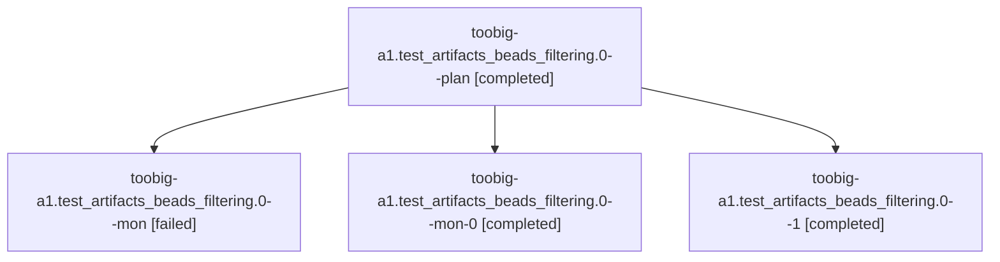

# Session: toobig-a1.test\_artifacts\_beads\_filtering.0

[Agent Hoods](../README.md) / [bbugyi200](../users/bbugyi200/README.md) / [athena](../users/bbugyi200/machines/athena/README.md) / [toobig-a1](../users/bbugyi200/machines/athena/hoods/toobig-a1/README.md) / toobig-a1.test\_artifacts\_beads\_filtering.0

Owner: `bbugyi200.athena` · Hood: `toobig-a1` · Members: 4

## Lineage

The diagram is an optional enhancement; the ordered table below contains the same lineage in accessible text.

| Role | Agent | State | Model / provider | Timing | Commits | Prompt | Chat |
|---|---|---|---|---|---:|---|---|
| plan | toobig-a1.test\_artifacts\_beads\_filtering.0--plan | completed | gpt-6-luna / codex | 2026-11-18T06:35:05.233230+00:00 → 2026-11-18T06:47:53.639686+00:00 | 0 | [Prompt](../agents/bbugyi200.athena.toobig-a1.test_artifacts_beads_filtering.0--plan/prompt.md) | [Chat](../agents/bbugyi200.athena.toobig-a1.test_artifacts_beads_filtering.0--plan/chat.md) |
| mon | toobig-a1.test\_artifacts\_beads\_filtering.0--mon | failed | gpt-6-luna / codex | 2026-11-18T06:46:38.257583+00:00 → 2026-11-18T06:59:20.685094+00:00 | 0 | — | [Chat](../agents/bbugyi200.athena.toobig-a1.test_artifacts_beads_filtering.0--mon/chat.md) |
| mon-0 | toobig-a1.test\_artifacts\_beads\_filtering.0--mon-0 | completed | gpt-6-luna / codex | 2026-11-18T07:05:37.232426+00:00 → 2026-11-18T07:16:19.971197+00:00 | [1](../agents/bbugyi200.athena.toobig-a1.test_artifacts_beads_filtering.0--mon-0/README.md#commits) | — | [Chat](../agents/bbugyi200.athena.toobig-a1.test_artifacts_beads_filtering.0--mon-0/chat.md) |
| 1 | toobig-a1.test\_artifacts\_beads\_filtering.0--1 | completed | gpt-6-luna / codex | 2026-11-18T06:59:20.557497+00:00 → 2026-11-18T07:06:39.459186+00:00 | 0 | [Prompt](../agents/bbugyi200.athena.toobig-a1.test_artifacts_beads_filtering.0--1/prompt.md) | [Chat](../agents/bbugyi200.athena.toobig-a1.test_artifacts_beads_filtering.0--1/chat.md) |

## Commits

| Role | Repo | Commit | Subject | Committed |
|---|---|---|---|---|
| mon-0 | sase | [`4305e73`](https://github.com/sase-org/sase/commit/4305e739f0062fe8047103dc7f1a10f62bbf132e) | refactor(tests): split artifact bead filtering tests | 2026-11-18 02:16:04 EST |

## Neighbors

| Agent | Relation | State |
|---|---|---|
| [toobig-a1.test\_leader\_keymap\_dispatch.0](../agents/bbugyi200.athena.toobig-a1.test_leader_keymap_dispatch.0/README.md) | toobig-a1 hood | waiting |
| [toobig-a1.viewer\_loop\_video.0](bbugyi200.athena.toobig-a1.viewer_loop_video.0.md) (session · 3) | toobig-a1 hood | completed 2, failed 1 |
| [toobig-a1.viewer\_video\_frames.0](../agents/bbugyi200.athena.toobig-a1.viewer_video_frames.0/README.md) | toobig-a1 hood | completed |
| [toobig-a1.workflow\_runner.0](bbugyi200.athena.toobig-a1.workflow_runner.0.md) (session · 3) | toobig-a1 hood | completed 2, failed 1 |
