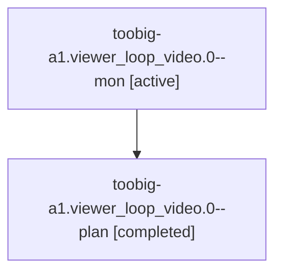

# Session: toobig-a1.viewer\_loop\_video.0

[Agent Hoods](../README.md) / [bbugyi200](../users/bbugyi200/README.md) / [athena](../users/bbugyi200/machines/athena/README.md) / [toobig-a1](../users/bbugyi200/machines/athena/hoods/toobig-a1/README.md) / toobig-a1.viewer\_loop\_video.0

Owner: `bbugyi200.athena` · Hood: `toobig-a1` · Members: 2

## Lineage

The diagram is an optional enhancement; the ordered table below contains the same lineage in accessible text.

| Role | Agent | State | Model / provider | Timing | Commits | Prompt | Chat |
|---|---|---|---|---|---:|---|---|
| mon | toobig-a1.viewer\_loop\_video.0--mon | active | muse-spark-1.3-contributor / muse | 2026-11-18T02:57:17.004358+00:00 | 0 | — | — |
| plan | toobig-a1.viewer\_loop\_video.0--plan | completed | muse-spark-1.3-contributor / muse | 2026-11-18T02:20:44.358482+00:00 → 2026-11-18T03:01:23.760940+00:00 | [1](../agents/bbugyi200.athena.toobig-a1.viewer_loop_video.0--plan/README.md#commits) | [Prompt](../agents/bbugyi200.athena.toobig-a1.viewer_loop_video.0--plan/prompt.md) | [Chat](../agents/bbugyi200.athena.toobig-a1.viewer_loop_video.0--plan/chat.md) |

## Commits

| Role | Repo | Commit | Subject | Committed |
|---|---|---|---|---|
| plan | sase | [`ba6ffc8`](https://github.com/sase-org/sase/commit/ba6ffc89955d3a09421c1c756fa3dce6f76f844c) | refactor(ace): split \_viewer\_loop\_video into modules under 500 lines | 2026-11-17 21:59:35 EST |

## Neighbors

| Agent | Relation | State |
|---|---|---|
| [toobig-a1.test\_artifacts\_beads\_filtering.0](../agents/bbugyi200.athena.toobig-a1.test_artifacts_beads_filtering.0/README.md) | toobig-a1 hood | waiting |
| [toobig-a1.test\_leader\_keymap\_dispatch.0](../agents/bbugyi200.athena.toobig-a1.test_leader_keymap_dispatch.0/README.md) | toobig-a1 hood | waiting |
| [toobig-a1.viewer\_video\_frames.0](../agents/bbugyi200.athena.toobig-a1.viewer_video_frames.0/README.md) | toobig-a1 hood | waiting |
| [toobig-a1.workflow\_runner.0](../agents/bbugyi200.athena.toobig-a1.workflow_runner.0/README.md) | toobig-a1 hood | waiting |
