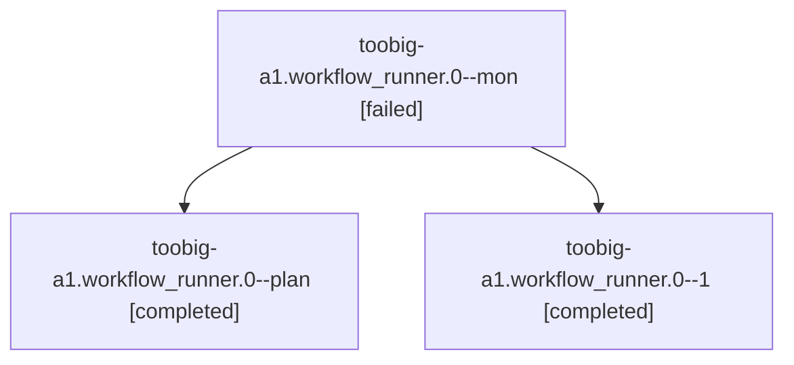

# Session: toobig-a1.workflow\_runner.0

[Agent Hoods](../README.md) / [bbugyi200](../users/bbugyi200/README.md) / [athena](../users/bbugyi200/machines/athena/README.md) / [toobig-a1](../users/bbugyi200/machines/athena/hoods/toobig-a1/README.md) / toobig-a1.workflow\_runner.0

Owner: `bbugyi200.athena` · Hood: `toobig-a1` · Members: 3

## Lineage

The diagram is an optional enhancement; the ordered table below contains the same lineage in accessible text.

| Role | Agent | State | Model / provider | Timing | Commits | Prompt | Chat |
|---|---|---|---|---|---:|---|---|
| mon | toobig-a1.workflow\_runner.0--mon | failed | muse-spark-1.3-contributor / muse | 2026-11-18T05:24:22.186046+00:00 → 2026-11-18T06:22:31.413670+00:00 | 0 | — | [Chat](../agents/bbugyi200.athena.toobig-a1.workflow_runner.0--mon/chat.md) |
| plan | toobig-a1.workflow\_runner.0--plan | completed | muse-spark-1.3-contributor / muse | 2026-11-18T05:04:36.966089+00:00 → 2026-11-18T05:25:37.541907+00:00 | 0 | [Prompt](../agents/bbugyi200.athena.toobig-a1.workflow_runner.0--plan/prompt.md) | [Chat](../agents/bbugyi200.athena.toobig-a1.workflow_runner.0--plan/chat.md) |
| 1 | toobig-a1.workflow\_runner.0--1 | completed | muse-spark-1.3-contributor / muse | 2026-11-18T06:22:31.048916+00:00 → 2026-11-18T06:28:41.130337+00:00 | [1](../agents/bbugyi200.athena.toobig-a1.workflow_runner.0--1/README.md#commits) | [Prompt](../agents/bbugyi200.athena.toobig-a1.workflow_runner.0--1/prompt.md) | [Chat](../agents/bbugyi200.athena.toobig-a1.workflow_runner.0--1/chat.md) |

## Commits

| Role | Repo | Commit | Subject | Committed |
|---|---|---|---|---|
| 1 | sase | [`226c12c`](https://github.com/sase-org/sase/commit/226c12c4c886fadb9ac03a095f0c88f0905861b8) | refactor(macro): split workflow\_runner into facade plus flatten and execute modules | 2026-11-18 01:28:27 EST |

## Neighbors

| Agent | Relation | State |
|---|---|---|
| [toobig-a1.test\_artifacts\_beads\_filtering.0](../agents/bbugyi200.athena.toobig-a1.test_artifacts_beads_filtering.0/README.md) | toobig-a1 hood | waiting |
| [toobig-a1.test\_leader\_keymap\_dispatch.0](../agents/bbugyi200.athena.toobig-a1.test_leader_keymap_dispatch.0/README.md) | toobig-a1 hood | waiting |
| [toobig-a1.viewer\_loop\_video.0](bbugyi200.athena.toobig-a1.viewer_loop_video.0.md) (session · 3) | toobig-a1 hood | completed 2, failed 1 |
| [toobig-a1.viewer\_video\_frames.0](../agents/bbugyi200.athena.toobig-a1.viewer_video_frames.0/README.md) | toobig-a1 hood | completed |
