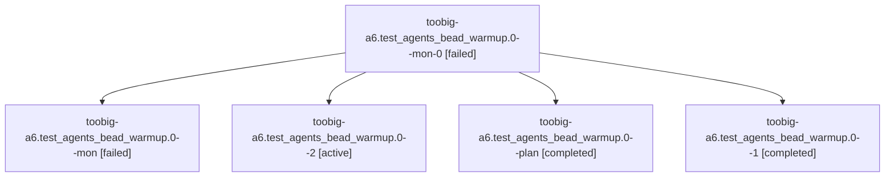

# Session: toobig-a6.test\_agents\_bead\_warmup.0

[Agent Hoods](../README.md) / [bbugyi200](../users/bbugyi200/README.md) / [athena](../users/bbugyi200/machines/athena/README.md) / [toobig-a6](../users/bbugyi200/machines/athena/hoods/toobig-a6/README.md) / toobig-a6.test\_agents\_bead\_warmup.0

Owner: `bbugyi200.athena` · Hood: `toobig-a6` · Members: 5

## Lineage

The diagram is an optional enhancement; the ordered table below contains the same lineage in accessible text.

| Role | Agent | State | Model / provider | Timing | Commits | Prompt | Chat |
|---|---|---|---|---|---:|---|---|
| mon-0 | toobig-a6.test\_agents\_bead\_warmup.0--mon-0 | failed | grok-4.6 / grok | 2026-11-19T00:13:39.693705+00:00 → 2026-11-19T00:30:09.342177+00:00 | 0 | — | [Chat](../agents/bbugyi200.athena.toobig-a6.test_agents_bead_warmup.0--mon-0/chat.md) |
| mon | toobig-a6.test\_agents\_bead\_warmup.0--mon | failed | grok-4.6 / grok | 2026-11-19T00:04:15.004747+00:00 → 2026-11-19T00:08:15.157179+00:00 | 0 | — | [Chat](../agents/bbugyi200.athena.toobig-a6.test_agents_bead_warmup.0--mon/chat.md) |
| 2 | toobig-a6.test\_agents\_bead\_warmup.0--2 | active | grok-4.6 / grok | 2026-11-19T00:30:09.034697+00:00 | 0 | [Prompt](../agents/bbugyi200.athena.toobig-a6.test_agents_bead_warmup.0--2/prompt.md) | — |
| plan | toobig-a6.test\_agents\_bead\_warmup.0--plan | completed | grok-4.6 / grok | 2026-11-18T23:56:18.306915+00:00 → 2026-11-19T00:06:12.808601+00:00 | 0 | [Prompt](../agents/bbugyi200.athena.toobig-a6.test_agents_bead_warmup.0--plan/prompt.md) | [Chat](../agents/bbugyi200.athena.toobig-a6.test_agents_bead_warmup.0--plan/chat.md) |
| 1 | toobig-a6.test\_agents\_bead\_warmup.0--1 | completed | grok-4.6 / grok | 2026-11-19T00:08:14.837448+00:00 → 2026-11-19T00:17:24.822840+00:00 | 0 | [Prompt](../agents/bbugyi200.athena.toobig-a6.test_agents_bead_warmup.0--1/prompt.md) | [Chat](../agents/bbugyi200.athena.toobig-a6.test_agents_bead_warmup.0--1/chat.md) |

## Neighbors

| Agent | Relation | State |
|---|---|---|
| [toobig-a6.test\_axe\_chop\_batch\_recovery.0](../agents/bbugyi200.athena.toobig-a6.test_axe_chop_batch_recovery.0/README.md) | toobig-a6 hood | waiting |
| [toobig-a6.test\_projected\_detail\_retention.0](../agents/bbugyi200.athena.toobig-a6.test_projected_detail_retention.0/README.md) | toobig-a6 hood | completed |
