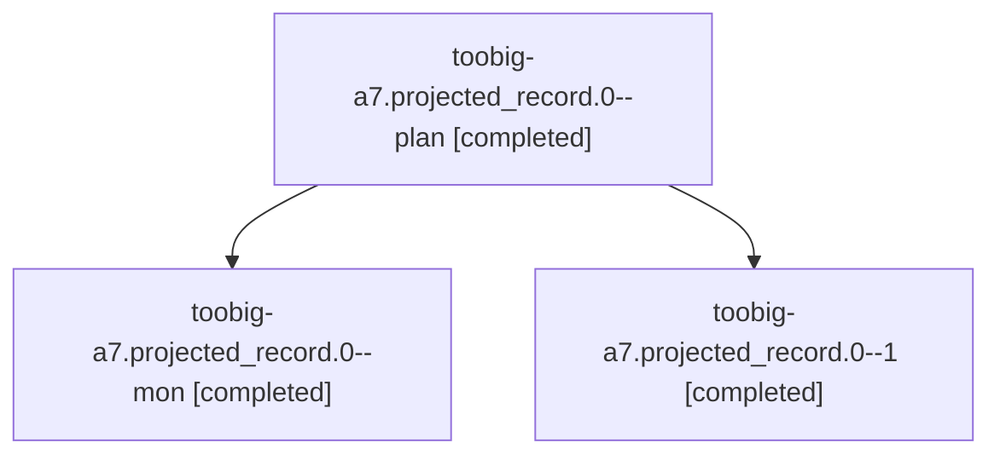

# Session: toobig-a7.projected\_record.0

[Agent Hoods](../README.md) / [bbugyi200](../users/bbugyi200/README.md) / [athena](../users/bbugyi200/machines/athena/README.md) / [toobig-a7](../users/bbugyi200/machines/athena/hoods/toobig-a7/README.md) / toobig-a7.projected\_record.0

Owner: `bbugyi200.athena` · Hood: `toobig-a7` · Members: 3

## Lineage

The diagram is an optional enhancement; the ordered table below contains the same lineage in accessible text.

| Role | Agent | State | Model / provider | Timing | Commits | Prompt | Chat |
|---|---|---|---|---|---:|---|---|
| plan | toobig-a7.projected\_record.0--plan | completed | muse-spark-1.3-contributor / muse | 2026-11-19T09:53:40.152004+00:00 → 2026-11-19T10:16:32.281031+00:00 | 0 | [Prompt](../agents/bbugyi200.athena.toobig-a7.projected_record.0--plan/prompt.md) | [Chat](../agents/bbugyi200.athena.toobig-a7.projected_record.0--plan/chat.md) |
| mon | toobig-a7.projected\_record.0--mon | completed | muse-spark-1.3-contributor / muse | 2026-11-19T10:15:14.354191+00:00 → 2026-11-19T10:29:07.997808+00:00 | 0 | — | [Chat](../agents/bbugyi200.athena.toobig-a7.projected_record.0--mon/chat.md) |
| 1 | toobig-a7.projected\_record.0--1 | completed | muse-spark-1.3-contributor / muse | 2026-11-19T10:29:07.576698+00:00 → 2026-11-19T10:33:01.187634+00:00 | [1](../agents/bbugyi200.athena.toobig-a7.projected_record.0--1/README.md#commits) | [Prompt](../agents/bbugyi200.athena.toobig-a7.projected_record.0--1/prompt.md) | [Chat](../agents/bbugyi200.athena.toobig-a7.projected_record.0--1/chat.md) |

## Commits

| Role | Repo | Commit | Subject | Committed |
|---|---|---|---|---|
| 1 | sase | [`b9718e1`](https://github.com/sase-org/sase/commit/b9718e15fd32b697702bd6f7cd9818cc1b5ae5d4) | refactor(ace): split \_projected\_record into facade plus detail/load/restore modules | 2026-11-19 05:32:48 EST |

## Neighbors

| Agent | Relation | State |
|---|---|---|
| [toobig-a7.test\_agents\_tab\_delta\_copy\_fast\_path.0](../agents/bbugyi200.athena.toobig-a7.test_agents_tab_delta_copy_fast_path.0/README.md) | toobig-a7 hood | completed |
