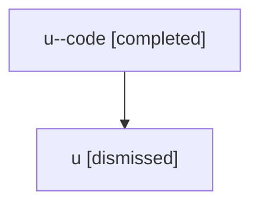

# Session: u

[Agent Hoods](../README.md) / [bbugyi200](../users/bbugyi200/README.md) / [athena](../users/bbugyi200/machines/athena/README.md) / [u](../users/bbugyi200/machines/athena/hoods/u/README.md) / u

Owner: `bbugyi200.athena` · Hood: `u` · Members: 2

## Lineage

The diagram is an optional enhancement; the ordered table below contains the same lineage in accessible text.

| Role | Agent | State | Model / provider | Timing | Commits | Prompt | Chat |
|---|---|---|---|---|---:|---|---|
| code | u--code | completed | gpt-5.5 / codex | 2026-07-06T23:33:23.762236+00:00 | [1](../agents/bbugyi200.athena.u--code/README.md#commits) | — | [Chat](../agents/bbugyi200.athena.u--code/chat.md) |
| root | u | dismissed | claude-fable-5 / claude | 2026-07-06T19:23:05.704230 → 2026-07-06T19:54:44.180081 | [1](../agents/bbugyi200.athena.u/README.md#commits) | [Prompt](../agents/bbugyi200.athena.u/prompt.md) | [Chat](../agents/bbugyi200.athena.u/chat.md) |

## Commits

| Role | Repo | Commit | Subject | Committed |
|---|---|---|---|---|
| — | — | `3be27db` | chore: Add SDD prompt and plan for slow\_tool\_calls\_metadata\_panel | 2026-07-03 12:19:30 EDT |
| — | — | `4536419` | feat(tui): surface slow tool calls in agent metadata | 2026-07-03 13:03:03 EDT |
| root | — | `3fe09a7` | chore: Add SDD prompt and plan for tab\_onboarding\_quickstart | 2026-07-06 19:33:22 EDT |
| code | — | `6fdd502` | feat(tui): add tab quickstart onboarding | 2026-07-06 19:54:27 EDT |
