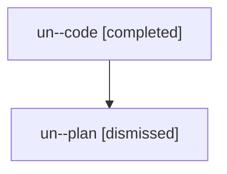

# Session: un

[Agent Hoods](../README.md) / [bbugyi200](../users/bbugyi200/README.md) / [athena](../users/bbugyi200/machines/athena/README.md) / [un](../users/bbugyi200/machines/athena/hoods/un/README.md) / un

Owner: `bbugyi200.athena` · Hood: `un` · Members: 2

## Lineage

The diagram is an optional enhancement; the ordered table below contains the same lineage in accessible text.

| Role | Agent | State | Model / provider | Timing | Commits | Prompt | Chat |
|---|---|---|---|---|---:|---|---|
| code | un--code | completed | sonnet / claude | 2026-08-07T13:38:35.837028+00:00 | [1](../agents/bbugyi200.athena.un--code/README.md#commits) | — | [Chat](../agents/bbugyi200.athena.un--code/chat.md) |
| plan | un--plan | dismissed | opus / claude | 2026-08-07T09:26:26.276348 → 2026-08-07T10:27:39.449588 | 0 | [Prompt](../agents/bbugyi200.athena.un--plan/prompt.md) | [Chat](../agents/bbugyi200.athena.un--plan/chat.md) |

## Commits

| Role | Repo | Commit | Subject | Committed |
|---|---|---|---|---|
| code | — | `7ca08ae` | fix(bead): render a bead's Notes section only when it has notes | 2026-08-07 10:25:17 EDT |

## Neighbors

| Agent | Relation | State |
|---|---|---|
| [un.w0](bbugyi200.athena.un.w0.md) (session · 2) | descendant | completed 1, dismissed 1 |
