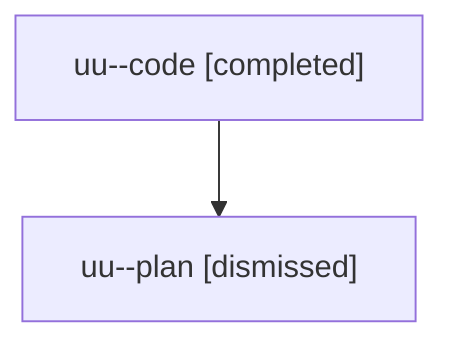

# Session: uu

[Agent Hoods](../README.md) / [bbugyi200](../users/bbugyi200/README.md) / [athena](../users/bbugyi200/machines/athena/README.md) / [uu](../users/bbugyi200/machines/athena/hoods/uu/README.md) / uu

Owner: `bbugyi200.athena` · Hood: `uu` · Members: 2

## Lineage

The diagram is an optional enhancement; the ordered table below contains the same lineage in accessible text.

| Role | Agent | State | Model / provider | Timing | Commits | Prompt | Chat |
|---|---|---|---|---|---:|---|---|
| code | uu--code | completed | sonnet / claude | 2026-08-07T17:25:30.651690+00:00 | [1](../agents/bbugyi200.athena.uu--code/README.md#commits) | — | [Chat](../agents/bbugyi200.athena.uu--code/chat.md) |
| plan | uu--plan | dismissed | opus / claude | 2026-08-07T13:16:19.242759 → 2026-08-07T13:59:32.653145 | 0 | [Prompt](../agents/bbugyi200.athena.uu--plan/prompt.md) | [Chat](../agents/bbugyi200.athena.uu--plan/chat.md) |

## Commits

| Role | Repo | Commit | Subject | Committed |
|---|---|---|---|---|
| code | — | `add38d7` | fix(ace): make Logs pane source rows non-wrapping and compact | 2026-08-07 13:52:19 EDT |
