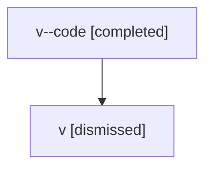

# Session: v

[Agent Hoods](../README.md) / [bbugyi200](../users/bbugyi200/README.md) / [athena](../users/bbugyi200/machines/athena/README.md) / [v](../users/bbugyi200/machines/athena/hoods/v/README.md) / v

Owner: `bbugyi200.athena` · Hood: `v` · Members: 2

## Lineage

The diagram is an optional enhancement; the ordered table below contains the same lineage in accessible text.

| Role | Agent | State | Model / provider | Timing | Commits | Prompt | Chat |
|---|---|---|---|---|---:|---|---|
| code | v--code | completed | gpt-5.5 / codex | 2026-07-06T23:31:50.771380+00:00 | [1](../agents/bbugyi200.athena.v--code/README.md#commits) | — | [Chat](../agents/bbugyi200.athena.v--code/chat.md) |
| root | v | dismissed | gpt-5.5 / codex | 2026-07-06T19:30:02.286136 → 2026-07-06T19:42:24.440999 | [1](../agents/bbugyi200.athena.v/README.md#commits) | [Prompt](../agents/bbugyi200.athena.v/prompt.md) | [Chat](../agents/bbugyi200.athena.v/chat.md) |

## Commits

| Role | Repo | Commit | Subject | Committed |
|---|---|---|---|---|
| — | — | `d2ac8c3` | chore: Add SDD prompt and plan for telegram\_enabled\_gate | 2026-07-03 14:03:03 EDT |
| root | — | `f48e881` | chore: Add SDD prompt and plan for nested\_agent\_docs\_provider\_shims | 2026-07-06 19:31:49 EDT |
| code | — | `17acd9f` | fix: manage nested agent doc provider shims | 2026-07-06 19:41:47 EDT |
