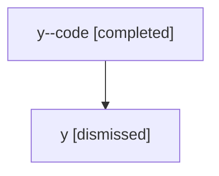

# Session: y

[Agent Hoods](../README.md) / [bbugyi200](../users/bbugyi200/README.md) / [athena](../users/bbugyi200/machines/athena/README.md) / [y](../users/bbugyi200/machines/athena/hoods/y/README.md) / y

Owner: `bbugyi200.athena` · Hood: `y` · Members: 2

## Lineage

The diagram is an optional enhancement; the ordered table below contains the same lineage in accessible text.

| Role | Agent | State | Model / provider | Timing | Commits | Prompt | Chat |
|---|---|---|---|---|---:|---|---|
| code | y--code | completed | gpt-5.5 / codex | 2026-07-07T02:41:11.708916+00:00 | [1](../agents/bbugyi200.athena.y--code/README.md#commits) | — | [Chat](../agents/bbugyi200.athena.y--code/chat.md) |
| root | y | dismissed | claude-fable-5 / claude | 2026-07-06T22:26:49.684684 → 2026-07-06T22:48:17.369609 | [1](../agents/bbugyi200.athena.y/README.md#commits) | [Prompt](../agents/bbugyi200.athena.y/prompt.md) | [Chat](../agents/bbugyi200.athena.y/chat.md) |

## Commits

| Role | Repo | Commit | Subject | Committed |
|---|---|---|---|---|
| — | — | `4add66d` | chore: Add SDD prompt and plan for tui\_title\_version | 2026-07-03 14:43:19 EDT |
| — | — | `9deb012` | feat(ace): show sase version instead of PID in the TUI title | 2026-07-03 15:40:55 EDT |
| root | — | `8b64dd4` | chore: Add SDD prompt and plan for sase\_run\_skill\_prompt\_guidance | 2026-07-06 22:41:10 EDT |
| code | — | `2894fd2` | docs: clarify sase\_run prompt composition | 2026-07-06 22:48:00 EDT |
